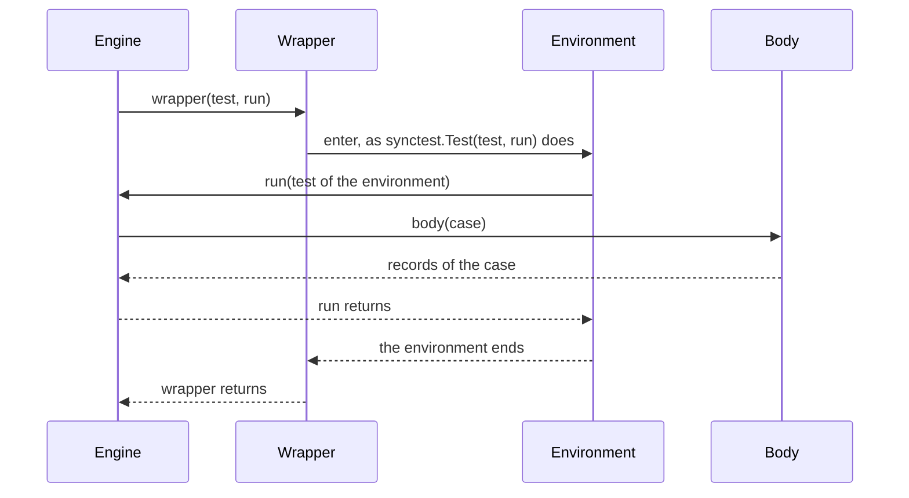

# RFC-0031: A wrapper around each run of a property

## Summary

A property cannot run its cases inside an environment that the test
platform gives one test, such as a `testing/synctest` bubble in Go. A test
can wrap the whole property in one environment. A fuzz target does not
offer a call to wrap, and the cases of one environment share its clock and
the tasks that each case leaves behind. This adds the option
`around(wrapper)`. The engine hands each run of the body to the wrapper,
and the wrapper runs it inside the environment that the test chooses:

```go
prop.ForAll(t, "each granted call returns before the invariant", limiterSteps, prop.Around(synctest.Test))
```

```go
prop.Fuzz(f, "each granted call returns before the invariant", limiterSteps, prop.Around(synctest.Test))
```

Definition 8.1.0 adds the option, and every language supplies it.

## Motivation

### A fuzz target cannot run a case inside a bubble

A goroutine that calls `synctest.Wait` outside a bubble panics. A body
that waits for the goroutines of its subject passes under `ForAll` inside
`synctest.Test`, because every case then runs inside the test's bubble.
The same body fails every input of a fuzz target. With assert-go at
d3fbd00 and Go 1.27.2:

```text
--- PASS: TestWaitInBubble (0.00s)
=== RUN   FuzzWait/seed#0
    a body waits for its goroutine: counterexample after 0 valid and 0 rejected cases, seed 14598061936248391101
      n: 0, any value fails
    failure at synctest.go:284: goroutine is not in a bubble: panic string, stack goroutine 28 [running]:
--- FAIL: FuzzWait (0.00s)
```

`testing.F` hands each input a `*testing.T`, and the property runs the
input's case. The body receives the case and not that test, so it cannot
enter a bubble itself. A machine of a subject with goroutines of its own
ends each step with `synctest.Wait`, so the property of such a subject
cannot run as a fuzz target. The machine of a rate limiter in the issue is
one: its waiting calls block on the timers of a fake clock.

### The cases of one bubble share its clock

A test that wraps the whole property in one environment runs every case
inside it. In one bubble, the cases of a property start at successive
fake times. A body that sleeps for one second, measured on Go 1.27.2:

| Case | Start |
|---|---|
| 0 | 2000-01-01T00:00:00Z |
| 1 | 2000-01-01T00:00:01Z |
| 2 | 2000-01-01T00:00:02Z |
| 3 | 2000-01-01T00:00:03Z |

Each case starts where the case before it left the clock. The shared clock
has two consequences:

- A shrink candidate and a replay start at other fake times than the case
  that failed. A subject whose result depends on the time can fail in one
  run and pass in the other.
- A goroutine or a timer that one case leaves behind keeps running during
  the cases after it.

A wrapper that the engine calls for each run gives each run an environment
of its own. Every run of a case then starts from the same fake time.

### The options belong to the definition

The options of a property are members of the definition, and a test
states them alike for `for-all`, for each form and for a fuzz target. An
option that one language ships beyond the standard has no name in the
naming table, so no other language states it alike. Every language has
the need, with an environment of its own.

## Detailed design

### The option

```text
Options                        each optional; the default follows the name
  around(wrapper)              runs each run of the body inside wrapper; none
```

A property takes one wrapper. Given more than once, the last one applies.

### The wrapper

```text
wrapper(test, run)
    Calls run once inside an environment that the wrapper chooses, and returns
    after run returns. test is the test that runs the property, where the
    language's environments take one.
run(test)
    Runs the body once. test is the test that the environment hands its
    function, where it hands one.
```

The engine calls the wrapper and the wrapper calls `run`:



The wrapper follows four rules:

- It calls `run` once. It may call `run` on another thread or task.
  `synctest.Test` runs its function on a goroutine of the bubble.
- `run` returns after the body and its cleanups end.
- The case's verdict comes from the body's records, so the wrapper cannot
  change it.
- The environment reports its own failures to the test, as a bubble
  reports a deadlock. The property's record does not state them.

A wrapper that returns without calling `run`, or that calls it a second
time, ends the call with a fault. The second call of `run` returns without
running the body.

### What runs inside the wrapper

The wrapper runs every run of the body:

- the case of `draws`
- each stored case
- the case whose every choice is its target, and every random, prefix and
  edge case
- each shrink candidate, and each filling that explains a draw
- each case of a campaign
- the case of `replay`
- the case of each input of the fuzz bridge

The engine's own work runs outside the wrapper: the seed of each case, the
case tree, the store, the shrinker's choice of the next candidate and the
record. The limits that read the platform clock run outside it too:
`shrink-time` and the budget of a campaign. A body draws its values inside
the wrapper, because it draws them while it runs.

A machine runs its steps in the body, so its steps run inside the wrapper.
Its concurrent section, its clients and the task scheduler run inside the
wrapper too.

### The cancellation handle of a case

A case takes its handle from the handle of the test that the environment
hands `run`, where it hands one. Otherwise the case takes it from the
handle of the property's seat, as it does without the option.

Go needs the rule. `synctest.Test` hands its function a `*testing.T`
whose context has a Done channel that belongs to the bubble. A body that
waits on that context blocks durably, so time in the bubble advances and
`synctest.Wait` returns. A context of a test outside the bubble does
neither.

### Workers

Under `workers(n)`, the engine calls the wrapper for up to n runs at once.
A wrapper must then be safe to run concurrently with itself, as the body
must be.

### Go

```go
// Around runs each run of the body inside wrap. wrap calls run once with
// a test, and returns after run returns. synctest.Test is such a function,
// and Around(synctest.Test) runs each run of the body in a bubble of its
// own.
func Around(wrap func(t *testing.T, run func(*testing.T))) Option
```

The type of the wrapper is the type of `synctest.Test`, so a test passes
that function itself. The wrapper takes a `*testing.T`, and the option has
three consequences in Go:

- `ForAll` takes a seat. Under `Around`, it ends the call with a fault for
  a seat that is no `*testing.T`.
- `Fuzz` hands the wrapper the `*testing.T` of each input.
- `Fuzz` replays its stored cases on the `testing.F` before it registers
  the target. `testing.F` does not give a wrapper a `*testing.T`, so under
  `Around` `Fuzz` runs each stored case inside the test of an input of the
  target instead.

### The other languages

Each language states the exact type of its wrapper in its own RFC. A
language whose environments take no test passes the wrapper `run` alone.
These environments of other platforms fit a wrapper:

- **TypeScript:** a wrapper calls `vi.useFakeTimers()` before `run` and
  `vi.useRealTimers()` after it. vitest 4.1.11 discards every timer of the
  run when the wrapper restores the real timers.
- **Rust:** a wrapper builds a tokio runtime for each run, and the
  runtime's clock starts paused. tokio 1.53.3 pauses only tokio's own
  `Instant`, and only on a `current_thread` runtime.

### Conformance

A vector pins the verdict and the record of an assertion. The wrapper is
an input of a test, so it has no vector. Each language tests the option
through its own tests:

- The wrapper runs once for each run of the body in each phase of a
  failing run: the generated case, each shrink candidate and each filling
  that explains a draw.
- A wrapper that does not call `run` ends the call with a fault, and so
  does one that calls it twice.
- The case's handle derives from the handle of the test that the
  environment hands `run`.

### Names

| Id | Go | Python | Rust | TypeScript | Java | Kotlin |
|---|---|---|---|---|---|---|
| `prop.around` | `prop.Around` | `prop.around` | `prop::around` | `prop.around` | `Prop.around` | `Prop.around` |

### Version

Adding an option is a minor version change. Definition 8.1.0 adds
`prop.around`, and every overlay extends 8.1.0.

## Alternatives considered

### A. An option that runs each case in the platform's fake time

The issue proposed `prop.Bubble()`, and Go's engine would run each case
through `synctest.Test` itself. In the definition, the option would state
what it gives a case: fake time. Each language would run the facility of
its platform.

**Why not:** the facilities differ, and one definition cannot state what
they share:

- A Go bubble fakes `time.Now` for every goroutine of the bubble, and
  advances the time when every goroutine is durably blocked.
- tokio's paused clock fakes only tokio's `Instant`. The `Instant` of std
  keeps the real time, and the runtime must be a `current_thread` runtime.
- vitest's fake timers replace the timer functions until `useRealTimers`.
  Their time does not move on its own unless `shouldAdvanceTime` makes it
  follow the real time.
- Python, Java and the standard library of Rust have no such facility.

A relation stated against a platform's own clock means something different
in each language, and the corpus cannot check it. A wrapper gives every
language the same option, and a Go test still states the bubble in one
argument.

### B. One environment around the property

A test runs the whole property inside the environment:
`synctest.Test(t, func(t *testing.T) { prop.ForAll(t, contract, body) })`.

**Why not:**

- A fuzz target does not offer a call to wrap, because `testing.F` runs
  each input itself.
- The cases share the clock of the environment and its leftover
  goroutines. In one bubble, each case starts at the fake time where the
  case before it ended.

### C. A platform test on the case

The case would return the platform test of its run, such as `c.T()` in
Go. The body would then enter the environment itself, as in
`synctest.Test(c.T(), func(*testing.T) { steps(c) })`.

**Why not:**

- A body that enters the environment itself cannot run without it, so one
  property cannot serve a test with the environment and one without it.
- The case's handle would derive from a test outside the bubble. A body
  that waits on it in Go does not block durably, and `synctest.Wait` does
  not return while the body waits.
- A recorder and every other seat that is no platform test have no test
  to hand the body.

### D. Hooks before and after each run

fast-check gives a property `beforeEach` and `afterEach`, which run before
and after each execution of the predicate. Its documentation marks both
deprecated in favour of its life-cycle plugins. jqwik gives a property
`@BeforeTry` and `@AfterTry` methods.

**Why not:** `synctest.Test` runs a function inside the bubble. A call
before a run and a call after it cannot enter that environment. jqwik
covers the same need with `AroundTryHook`, which wraps the execution of
each try as this wrapper does.

### E. A wrapper that can change the verdict

jqwik's `AroundTryHook` returns the try's result. Its documentation states
that a hook can change the result "from satisfied to falsified or the
other way round".

**Why not:** a wrapper that passes a failing case hides the failure from
the shrinker and the store. The verdict comes from the body's records
alone.

## Drawbacks

- Each language gains one option, and its engine counts the calls of
  `run` to find a wrapper that skips the run or repeats it.
- Every run of the body costs a call of the wrapper. `synctest.Test`
  around an empty function took 1.68 µs and 12 allocations per call,
  measured on Go 1.27.2 on an AMD Ryzen 9 9950X3D. A shrink of 2,000 runs
  adds about 3.4 ms.
- The wrapper is the caller's code inside the engine's loop. A wrapper
  that blocks stalls the run.
- A property on more than one worker needs a wrapper that is safe to run
  concurrently with itself.
- In Go the option needs a `*testing.T`. `ForAll` refuses it on any other
  seat, and a failing stored case of a fuzz target fails the test of an
  input instead of the fuzz test.
- No vector covers the option.
- The naming table gains one row.

## Unresolved and future work

This proposal does not add a wrapper to any language. A language could
supply one for the environment of its platform, such as a wrapper that
enters vitest's fake timers. Adding one is a change of that language
alone.

## References

| What | Where |
|---|---|
| The issue that asked for the option | <https://github.com/dokimasia/assert-go/issues/55> |
| `synctest.Test`, `synctest.Wait` and the context of a bubble's test | `src/testing/synctest/synctest.go` in Go 1.27.2 |
| tokio's paused clock | `src/time/clock.rs` in tokio 1.53.3 |
| vitest's fake timers and `shouldAdvanceTime` | The declarations of `VitestUtils` and `FakeTimerInstallOpts` in vitest 4.1.11 |
| jqwik's `AroundTryHook` | `api/src/main/java/net/jqwik/api/lifecycle/AroundTryHook.java` in jqwik 1.10.2 |
| fast-check's `beforeEach` and `afterEach` | <https://fast-check.dev/docs/core-blocks/properties/> |
