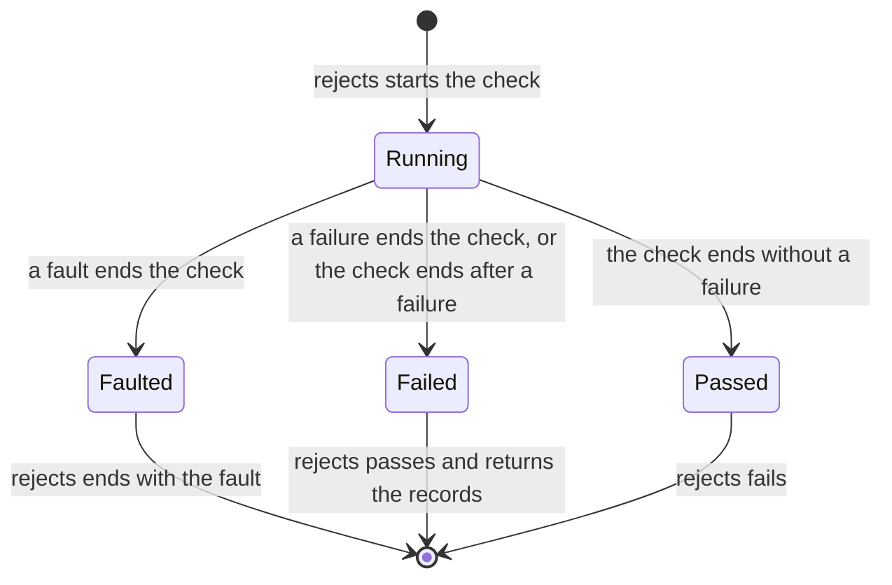

<!--
  ~ Copyright Dokimasia B.V. 2026
  ~ SPDX-License-Identifier: MIT
-->

# RFC-0034: A check that ends with a fault

## Summary

`rejects` passes when its check fails against an implementation that the
check is meant to reject. Go and Rust also count a check that ends with a
fault as a rejection, so `rejects` passes for a check that has no verdict
on the implementation. This proposal ends the call of `rejects` with the
fault of its check:

- A fault that ends the check ends the call of `rejects` with the same
  fault.
- The call record of `rejects` states the verdict `error` and the text of
  the fault.
- A failure of the check that stops it, and a message that the check sends
  through `fail` or `record`, count as a rejection as before.

Definition 10.0.0 makes the change.

## Motivation

### A fault rejects nothing

A check that ends with a fault refused an argument or its environment
before it had a verdict on the implementation. On assert-go v0.5.1
this test passes, and `got` is empty:

```go
func TestRejectsCountsAFault(t *testing.T) {
	got := assert.Rejects(t, "the check rejects the implementation", func(tb assert.TB) {
		_ = assert.ErrorAs[int](tb, errors.New("not found"), "the error is an int")
	})
	t.Logf("Rejects passed and returned %d records", len(got))
}
```

`ErrorAs[int]` ends the check with the fault "the type int is no interface
and does not implement error". The documentation of `Rejects` states the
rule: "A message that fn passes to Fatalf or Errorf of its seat, and a fault
of this module, fail fn without a record. Rejects passes then."

The languages disagree today:

| Language | A check that ends with a fault of the library |
|---|---|
| Go | Fails without a record, and `rejects` passes |
| Rust | Fails without a record, and `rejects` passes |
| Python | Raises `FaultError`, and `rejects` ends with the fault |
| TypeScript | Throws `Fault`, and the promise of `doesReject` rejects with the fault |

### A harness that falsifies checks reads the fault as text

The conformance runner `go.dokimi.dev/conform` keeps the first message that
a check reports outside an assertion, and its falsification fails on that
message. It sees a fault of assert only because assert sends the fault as
text through `Fatalf` of the handle. Once a seat takes a fault as the error
it is, the falsification would pass a fault that a seat below the handle
takes.

### A panic of the check is no rejection either

assert-go already ends a call of `Rejects` this way for a panic: "A check
that panics is a defect in the check or in the wrong implementation, and
reporting it as a rejection would hide it." A fault is the same kind of
defect.

## Detailed design

### The assertion

```yaml
"rejects":
  arity: 2
  summary: >
    A check fails against an implementation it is meant to reject.
    Yields the failure records of the check, in call order. A fault
    that ends the check ends the call with the same fault.
  detail_fields: []
```

### The seat of the check

The seat that `rejects` hands its check states `report-fault`:

- A fault with `ending` true ends the check, as a failure that stops ends
  it. The seat keeps the fault.
- A fault with `ending` false passes to the seat of `rejects` unchanged,
  with `ending` false, and the check runs on.

In Python and TypeScript, a fault of the library that the check raises also
ends the check, and `rejects` keeps it in the same way.

### The end of the call

After the check ends, `rejects` reads its outcome in this order:

1. A kept fault ends the call of `rejects` with that fault. The call record
   of `rejects` states the verdict `error` and the text of the fault.
   `rejects` passes the fault to its own seat as `fault` passes a fault, and
   returns no records.
2. A check that failed passes `rejects`, which returns the check's records.
3. A check that passed fails `rejects`.

The calls of the check are recorded under the call of `rejects`, as run 1,
in every case. A check that fails at an assertion and then ends with a
fault ends `rejects` with the fault: the fault means that the check did not
finish.



### The languages

The signatures do not change. The documentation of each `rejects` states
the rule:

- **Go:** the seat of the check implements `FaultReporter`. `Rejects`
  passes the fault to `assert.Fault` of its own seat, which returns only
  for a seat that takes the fault.
- **Rust:** the seat of the check overrides `report_fault`. `rejects`
  hands the fault to `report_fault` of its own seat, and returns an empty
  list.
- **Python:** the seat of the check states `report_fault`, and `rejects`
  keeps raising a `FaultError` of the check.
- **TypeScript:** the seat of the check states `reportFault`, and
  `doesReject` keeps rejecting with a thrown `Fault` of the check.

### Conformance

`rejects` takes a check that no corpus case can state. Each implementation
tests these checks itself:

- A check that ends with a fault of the library ends `rejects` with the
  same fault, and the call record of `rejects` states the verdict `error`.
- A check that calls `fault` with an error of its own ends `rejects` with
  that error.
- A check that notes a fault and then fails passes `rejects`, and the seat
  of `rejects` receives the noted fault.

### Version

A test passes today when its check ends with a fault, and fails after the
change. A change of what an existing assertion means is a major version
change. Definition 10.0.0 changes `rejects`.

## Alternatives considered

### A. A fault as a rejection, as today

**Why not:** `rejects` exists to prove that a check can fail on what it is
about. A fault shows that the check stopped before it called its subject,
and a harness of generated checks would count a broken check as a check
that works.

### B. A failure of `rejects` for a fault

`rejects` would fail with its own record when its check ends with a fault.

**Why not:** a failure of `rejects` states that the check passed against
the wrong implementation. A fault states that no verdict exists. The call
record would then state the verdict `fail` for a call that has no verdict,
and the fault's error would not reach the seat.

### C. A record of the fault among the records of the check

`rejects` would pass, and return a record of the fault beside the records
of the check.

**Why not:** a reader of the records would have to tell a fault from a
failure of an assertion, and a bare call of `rejects` would still pass.

## Drawbacks

- A test whose check ends with a fault passes today and fails after the
  change. The test then shows a defect that the pass hid.
- Each language's seat of the check states `report-fault`, the member that
  the same release adds to the seat.
- Mutation testing that uses `rejects` reports a mutant whose check ends
  with a fault as an error of the run, not as a killed mutant. Stryker
  treats a run that ends with an error the same way.

## Unresolved and future work

This proposal does not change `eventually`. An attempt of `eventually`
that ends with a fault keeps the outcome that each language gives it today.

## References

| What | Where |
|---|---|
| The issue | <https://github.com/dokimasia/assert-spec/issues/15> |
| The documentation of `Rejects` in assert-go v0.5.1 | `rejects.go`, lines 35 to 55 |
| The falsification of conform | `conform/handle.go` and `conform/check.go` of dokimasia/dokimi-go at 15f33fa |
| Stryker's mutant state Runtime error | <https://stryker-mutator.io/docs/mutation-testing-elements/mutant-states-and-metrics/> |
| The member `report-fault` and the helper `fault` | RFC-0033 |
