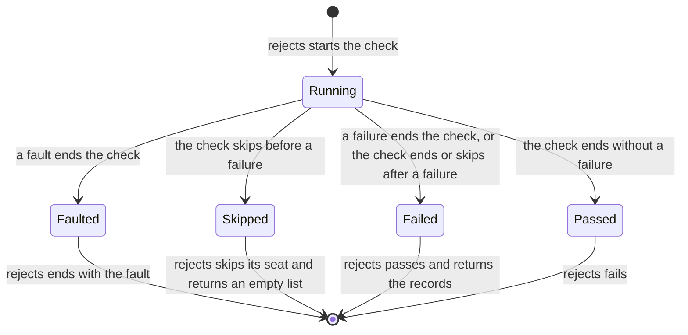

<!--
  ~ Copyright Dokimasia B.V. 2026
  ~ SPDX-License-Identifier: MIT
-->

# RFC-0040: A check that skips under rejects

## Summary

`rejects` runs its check on a seat of its own, and that seat cannot skip.
A check whose environment lacks a capability skips the test that runs it,
and a case of a property skips its run. Under `rejects`, conform's handle
ends the same check with a fault. This proposal lets the check skip
there:

- The seat gains the member `skip`. A seat whose test runner can skip a
  running test skips the test with the reason.
- The seat that `rejects` hands its check ends the check at a skip, as a
  failure that stops ends it.
- A check that skips before it fails ends the call of `rejects` as
  skipped. The call does not yield failure records, and `rejects` passes
  the skip to its own seat.
- A check that fails and then skips ends the call with its failure
  records, as a run of `for-all` keeps a failing case over a later skip.
- The call record of every call that skips states the reason in the new
  field `reason`.

Definition 12.1.0 adds the member, the end of the call and the field.

## Motivation

### The falsification of a check that needs a disk

conform runs the falsification of each check of a suite inside
`rejects`. It plants the defect that the check states, and requires the
check to fail. A check of a log suite needs the disk that the variable
`CHAIN_DISK` names, and it skips through its handle where the variable
is empty:

```go
// KeepsTheBodyOnDisk checks that Replay returns the body that Append admitted,
// where the log has a disk.
//
//dokimi:check Log.Replay defect=losesBodiesOnDisk
func KeepsTheBodyOnDisk(h *LogHandle) {
	if os.Getenv("CHAIN_DISK") == "" {
		h.Skipf("the check needs the disk of %s", "CHAIN_DISK")
	}
	KeepsTheBody(h)
}
```

On a machine without the disk, the applications of the suite skip the
check. The handle looks for `Skipf` on its seat. Under the falsification,
that seat is the seat of `rejects`, which has no `Skipf`. The handle
ends the check with a fault, and `Rejects` ends the test of the
falsification with that fault. With assert-go v0.7.1 and conform v0.3.0:

```text
--- FAIL: TestLogSuite/LogSuite/Replay/keeps-the-body-on-disk (0.00s)
    chain_suite_test.go:30: conform: the handle cannot skip the check: the seat of Log.Replay/keeps-the-body-on-disk has no Skipf
```

The falsification passes on a machine with the disk and fails on a
machine without one. Neither the check nor the subject has a defect.

### No seat of a check can skip

| Language | A check that skips under `rejects` today |
|---|---|
| Go | The seat of the check has no `Skipf`, so conform's handle ends the check with a fault |
| Python | The seat of the check has no `skip`. A `unittest.SkipTest` that the check raises leaves `rejects` before the call reports a verdict, and the test skips |
| Rust | `Seat` has no member that skips, and libtest has no call that skips a running test |
| TypeScript | The seat of the check has no `skip` |
| Java, Kotlin | `Seat` has no member that skips |

### The capability that only the check can probe

A caller can decide the skip on its own seat before it calls `rejects`,
for a capability that the caller can probe. The factory of a file system
check finds a missing capability when it creates the subject, inside the
check: the file system refuses direct I/O with `ErrUnsupported`. To skip
before the call, the caller would have to create each subject a second
time, outside the check.

## Detailed design

### The member

```text
Seat
  skip(reason)
      Skips the test of the seat with reason, where the seat's test
      runner can skip a running test.
```

A case of a property is a seat, and its member is the member `skip` of
the case that RFC-0038 states. Python, Rust, TypeScript, Java and Kotlin
state the member as they state `report-fault`. Go takes the member
`Skipf` that `testing.TB` declares:

| Language | The member | Seats that skip their test |
|---|---|---|
| Go | `Skipf(format string, args ...any)`, the member of `testing.TB`, found along the seats that `Unwrap` returns | `*testing.T`, `*testing.B`, `*testing.F` and `*prop.Case` |
| Python | `skip(reason: str) -> None`, an optional member | `Standard` and `Collector`, which raise `unittest.SkipTest` |
| Rust | `fn skip(&self, reason: &str)`, a provided method of `Seat` | None. The default writes the reason to the standard error and returns |
| TypeScript | `skip?(reason: string): never`, an optional member | The seat of the vitest fixture `test`, which calls `skip` of the test context |
| Java, Kotlin | `skip(reason)` on the interface `Skipper`, as `report-fault` is on `FaultReporter` | A JUnit seat, which calls `Assumptions.abort(reason)` |

A recorder has no member in Go, Python, TypeScript, Java and Kotlin. In
Rust a recorder keeps the default.

### The seat of the check

The seat that `rejects` hands its check states `skip`. The member keeps
the reason of the first skip and ends the check, as a failure that stops
ends it:

- Go ends the goroutine of the check, as the seat's `Fatalf` does.
- Python and TypeScript raise the signal with which the seat ends the
  check.
- Rust unwinds with the payload with which the seat ends the check.
- Java and Kotlin throw the signal with which the seat ends the check.

The seat keeps a failure that the check reported before the skip. A fault
that the check noted before the skip has already passed to the seat of
`rejects`.

### The end of the call

After the check ends, `rejects` reads its outcome in this order:

1. A kept fault ends the call of `rejects` with that fault. The call
   record states the verdict `error`, as RFC-0034 states.
2. A check that skipped before it failed ends the call as skipped. The
   call record states the verdict `skip` and the reason. `rejects` passes
   the skip to its own seat through `skip`, and returns an empty list of
   records. On a seat without the member, the call returns the empty list,
   and the test runs on.
3. A check that failed passes `rejects`, which returns the check's
   records. A check that failed and then skipped ends here.
4. A check that passed fails `rejects`.



A skip is not a verdict on the implementation, so it ends the call on
both surfaces. The calls of the check are recorded under the call of
`rejects`, as run 1, in every case.

### The call record

The call record gains one field:

| Field | Value | Present |
|---|---|---|
| `reason` | The reason of the skip | On `skip` |

The verdict `skip` covers the new end of `rejects`:

| `verdict` | The call |
|---|---|
| `skip` | The run of a property ended at a case that called `skip`, or the check of `rejects` skipped before it failed. The test skips where its runner can skip a running test |

A property's record states `reason` beside the field `reason` of its
detail. A reader then finds the reason of every skip in one field.

A skipped call of `rejects`:

```json
{
  "definition": "12.1.0",
  "seq": 1,
  "assertion": "rejects",
  "contract": "the planted defect of Log.Replay/keeps-the-body-on-disk fails the check",
  "verdict": "skip",
  "aborting": true,
  "where": { "file": "check.go", "line": 112 },
  "reason": "the check needs the disk of CHAIN_DISK"
}
```

### The rule in `conformance.md`

The Fixed tier gains a rule beside the rule of how a seat receives a
fault:

> **How a seat skips its test.** A seat that states `seat.skip` skips its
> test with the reason, where its runner can skip a running test. The
> seat of the check of `rejects` keeps the reason and ends the check, and
> `rejects` then ends its own call as skipped. A skip is an input of a
> test, so no corpus case pins it, and each language checks it in its own
> tests.

### The languages

The signature of `rejects` does not change. Its documentation states the
new end:

```go
// Rejects ...
//
// A check that calls Skipf of its seat before it fails ends the call as
// skipped. The call record states the verdict skip and the reason. Rejects
// skips the first seat of tb's chain that has Skipf, and returns no
// record. A chain without Skipf, such as a Recorder, receives nothing.
func Rejects(tb TB, msg string, fn func(tb TB)) []Failure
```

```python
def rejects(seat: Seat, msg: str, body: Callable[[Any], object]) -> list[Failure]:
    """...

    A check that calls skip of its seat before it fails ends the call as
    skipped. The record of rejects states the verdict skip and the reason.
    rejects calls skip of seat where the seat has the member, and returns an
    empty list.
    """
```

```rust
pub trait Seat {
    /// Skips the test of the seat with `reason`, where the test runner can
    /// skip a running test.
    ///
    /// The default writes the reason to the standard error and returns,
    /// because libtest has no call that skips a running test. On the seat
    /// that `rejects` hands its check, `skip` ends the check. On a case, it
    /// ends the run of the property. A caller returns after `skip`.
    fn skip(&self, reason: &str) {
        eprintln!("skipped: {reason}");
    }
}
```

```typescript
interface Seat {
  /**
   * Skips the test of the seat with reason. The seat of the vitest fixture
   * calls skip of the test context, and the seat that doesReject hands its
   * check ends the check.
   */
  skip?(reason: string): never;
}
```

```java
/// A seat whose test can skip while it runs.
public interface Skipper {
  /// Skip the test of this seat, with reason.
  void skip(String reason);
}
```

Kotlin takes the same interface. assert-java implements definition
9.0.0. Its move to 12.1.0 adds the member to its seats.

### Names

| Id | Go | Python | Rust | TypeScript | Java, Kotlin |
|---|---|---|---|---|---|
| `seat.skip` | `Skipf` | `skip` | `skip` | `skip` | `skip` |
| `skipper` | | | | | `Skipper` |

Go names the member `Skipf`, the member of `testing.TB` that skips a test
with a formatted reason, as it names `case.skip`. Java and Kotlin state
the member on the interface `Skipper` for the reason that they state
`report-fault` on `FaultReporter`.

### The overlays

| Overlay | Entry |
|---|---|
| `rust.json` | A limit on `seat.skip`: the default writes the reason and returns, and the test passes. libtest has no call that skips a running test |
| `typescript.json` | A limit on `seat.skip`: only the seat of the vitest fixture skips its test. Under jest the call record states the skip, and the test passes |

### Conformance

`rejects` takes a check that no corpus case can state. Each
implementation tests these checks itself:

- A check that calls `skip` before it fails ends `rejects` as skipped.
  `rejects` returns an empty list, and its call record states the verdict
  `skip` and the reason.
- A test's seat that can skip skips the test. A recorder keeps the call
  record, and the call returns.
- A check that records a failure and then skips passes `rejects`, which
  returns the check's records.
- A check that notes a fault and then skips ends `rejects` as skipped,
  and the seat of `rejects` receives the noted fault.

The vectors of `recording.json` whose property skips state the reason in
their outputs, so the vectors pin the field `reason` for a property. The
completeness gate checks the rows `seat.skip` and `skipper`.

### Version

The change adds a member of the seat and a field of the call record that
only a skip states. It also adds an end of `rejects`, which a check
produces only through a call of the new member. A call whose check does
not skip keeps its meaning. No seat of a check states the member today,
and a Python check that raises `unittest.SkipTest` keeps today's
behaviour. RFC-0010 makes a new member of the case a minor version. A new
member of the seat is one as well, so the definition moves to 12.1.0.
Every overlay extends 12.1.0.

## Alternatives considered

### A. The caller skips before the call

The caller decides the skip on its own seat before it calls `rejects`,
as it can today.

**Why not:** a check that finds the missing capability through its
subject decides inside the check. The caller would probe the environment
a second time, outside every check.

### B. A skip as a fault

conform's handle ends the check with a fault today, and `rejects` ends
with that fault. JUnit's `assertThrows` treats an aborted assumption the
same way. It fails the assertion with "Unexpected exception type thrown"
for every exception of another type than the expected one.

**Why not:** on every machine without the capability, the falsification
would fail although the check and the subject are sound. A fault means
that the check refused an argument or its environment. A skip means that
the environment cannot run the check, and outside `rejects` the same
check skips its test.

### C. A skip as a rejection

`rejects` would count a skip as a failure of the check, pass, and return
the records.

**Why not:** a check that skipped never ran against the implementation.
`rejects` would pass for a check that did not test anything. RFC-0034
removed the same defect for a fault.

### D. A skip that leaves the call without a verdict

The skip would pass through `rejects` as an exception, as a raised
`unittest.SkipTest` passes through Python's `rejects` today. unittest's
`assertRaises` and pytest's `raises` let a skip through in the same way.
A test that calls `pytest.skip` inside `pytest.raises(AssertionError)`
skips on pytest 9.1.1, because pytest's skip exception derives from
`BaseException`.

**Why not:** the call does not report a verdict, so a recorded run does
not contain its call record. A recorder then has no outcome of the call
to read. Go and Rust end a check without an exception, so they cannot
pass a skip through this way.

### E. The reason in the detail of `rejects`

`rejects` would declare the detail field `reason`.

**Why not:** the detail of a failure states every declared field, so a
failing call of `rejects` would state `reason` as null. RFC-0010 makes a
change of a detail field a major version.

### F. A skip that ends the call after a failure

A check that fails and then skips would end the call as skipped.

**Why not:** the failure has already rejected the implementation.
Ending the call as skipped would hide that rejection.
RFC-0038 keeps a failing case of a property over a later skip in the same
way.

### G. A raised `unittest.SkipTest` as a skip in Python

Python's `rejects` would read a raised `unittest.SkipTest` as a call of
`skip`. Both ways of skipping would then give one record.

**Why not:** `pytest.skip` raises pytest's `Skipped`, and `Skipped` does
not derive from `unittest.SkipTest`. The record of a check would then
depend on the runner whose call the check makes. No other part of the
library interprets an exception of a test runner.

## Drawbacks

- Every implementation of `rejects` changes, and every implementation
  writes the field `reason`. Go adds `Skipf` to the internal seat of the
  check and does not change a public name. Python and TypeScript add
  `skip` to the seat of the check. Rust adds a provided method to `Seat`
  and overrides it on the seat of a body and on `Case`. Java and Kotlin
  add the interface `Skipper` and implement it on the JUnit seat and on
  the seat of the check.
- A falsification under `rejects` runs only where the capability exists.
  A machine without it skips the test of the falsification, so that
  machine does not show whether the check detects its planted defect.
- Rust and a TypeScript test under jest cannot skip a running test. The
  test of the falsification passes there, and its call record states the
  skip.
- A property states its reason twice: in its detail and in `reason`.
- Python keeps two ways for a check to skip. `rejects` reads a call of
  `skip`, and a raised `unittest.SkipTest` leaves the call without a
  verdict.

## Unresolved and future work

- This proposal does not change `eventually`. An attempt whose check
  skips keeps the outcome that each language gives it today.
- This proposal does not add a Go helper that skips through any
  `assert.TB`, as `assert.Context` reads a context. `*testing.T`,
  `*prop.Case` and the seat of `rejects` state `Skipf`, and a wrapper such
  as conform's handle finds it.

## References

| What | Where |
|---|---|
| The issue | <https://github.com/dokimasia/assert-spec/issues/22> |
| conform's falsification, which calls `Rejects` | <https://github.com/dokimasia/dokimi-go/blob/392594e/conform/check.go#L112> |
| conform's `Handle.Skipf` | <https://github.com/dokimasia/dokimi-go/blob/392594e/conform/handle.go#L228-L245> |
| JUnit's `assertThrows` | <https://github.com/junit-team/junit-framework/blob/fa76160/junit-jupiter-api/src/main/java/org/junit/jupiter/api/AssertThrows.java#L50-L77> |
| pytest 9.1.1, `Skipped` and `OutcomeException` | <https://github.com/pytest-dev/pytest/blob/9.1.1/src/_pytest/outcomes.py#L13-L39> |
| The call record and its verdicts | RFC-0016 |
| The end of the call of `rejects` | RFC-0034 |
| The skip of a case | RFC-0038 |
