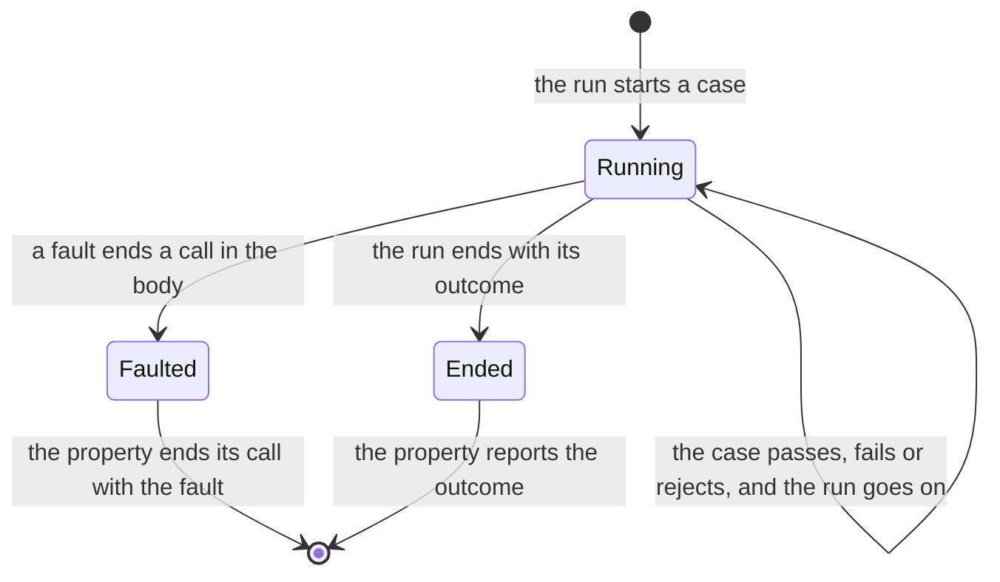

<!--
  ~ Copyright Dokimasia B.V. 2026
  ~ SPDX-License-Identifier: MIT
-->

# RFC-0042: A case that ends with a fault

## Summary

A body that ends its case with a fault fails the case today. The engine
then shrinks the fault as a counterexample, although a fault has no
verdict on the property. This proposal ends the run of the property with
the fault instead:

- A case states `seat.report-fault`. A fault that ends a call in the body
  ends the case and keeps the fault.
- The kept fault ends the run in every phase. The run does not shrink or
  store the case, and the property does not report a record of its
  assertion.
- The call record of the property states the verdict `error` and the text
  of the fault. The property passes the fault to its own seat as `fault`
  passes a fault.
- A fault that the body notes passes to the seat of the property, and the
  case runs on.

Definition 13.0.0 makes the change.

## Motivation

### A fault becomes a counterexample

A fault is an error that ends a call without a verdict: an argument or an
environment that the call refuses. On assert-go v0.9.0 a body that calls
`assert.Fault` fails its case with the text of the fault. The run shrinks
the fault through 6 more cases and reports a counterexample:

```text
cases run: 7
faults: 0
failures: 1
failure: assertion="prop-for-all" contract="every case passes" case=true inner assertion="" inner contract="probe: the environment lacks the resource"
```

The record of the case keeps the text of the fault alone, so `errors.Is`
cannot match the fault.

### A harness of checks reads the counterexample as a verdict

The conformance runner `go.dokimi.dev/conform` falsifies each check of a
suite: it applies every other check of the suite to a planted defect. A
check whose handle lacks an option ends with a fault. An apply check then
has no verdict, because `assert.Fault` passes the fault to the recorder of
the falsification. A property check reports a counterexample whose
failure has no assertion. The falsification reads that counterexample as
a verdict on the defect, and the spec of the suite fails.

### The languages fail the case in three ways

| Language | A fault that ends a call in the body |
|---|---|
| Go | `Case` has no `ReportFault`, so `Fault` sends the text through `Fatalf`, which fails the case |
| Python | `Case.report_fault` fails the case with the text of the fault. A raised `FaultError` fails the case as any raised error does |
| Rust | `Case::report_fault` fails the case with the text of the fault |
| TypeScript | `Case` has no `reportFault`, so `fault` throws, and the thrown `Fault` fails the case as any thrown error does |

RFC-0034 ends the call of `rejects` with the fault of its check, because
such a check has no verdict on the implementation. The definition states
no rule of this kind for a property.

## Detailed design

### The case

A case states `seat.report-fault`:

- A fault with `ending` true ends the case, as a failure that stops ends
  it. The case keeps the first such fault and runs its cleanups.
- A fault with `ending` false passes to the seat of the property
  unchanged, with `ending` false, and the body runs on.

In Python and TypeScript, a fault of the library that the body raises also
ends the case, and the case keeps it in the same way.

A case that keeps a fault ends with the fault, also when the body reported
a failure before the fault. The fault means that the body did not finish.

### The run

Each of these cases ends the run when a fault ends it:

- the case of `draws`, an example, a stored case, the simplest case, and a
  random, prefix, edge or coverage case
- the replay that confirms a failure, a shrink candidate, and each filling
  and boundary step of the explain phase
- a case of a campaign, and the case of a replay token
- the case of an input of a fuzz target

The run starts no further case. A run on more than one worker takes the
results in the order of a run on one, so it ends at the same case. The run
does not shrink, explain or store a case. A campaign keeps the entries of
the failures that it concluded before the fault.

A skip ends the run only before the first failure, because a shrinker
moves each value towards its target and can try an input that skips. A
fault differs. It states that the run cannot check the property for any
input. A run that went on past a fault would report a counterexample whose
shrink or explanation the fault cut short.

### The end of the call

The property ends its call with the kept fault:

- The call record of the property states the verdict `error` and the text
  of the fault, and no detail.
- The property passes the fault to its own seat as `fault` passes a fault.
  A seat that states `seat.report-fault` receives it with `ending` true.
  Any other seat ends the call as the language ends a call with a fault.
- The property does not report a record of its assertion.

The calls of the cases before the fault, and of the case that kept it, are
recorded under the property, as for every other run.



### The languages

The signatures do not change, except that a case of Go and TypeScript gains
the member. The documentation of each property states the rule.

- **Go:** `*prop.Case` implements `assert.FaultReporter`.
- **Python:** `Case.report_fault` ends the case and keeps the fault. A
  `FaultError` that the body raises ends the case in the same way.
- **Rust:** `Case::report_fault` ends the case and keeps the fault.
- **TypeScript:** `Case.reportFault` ends the case and keeps the fault. A
  `Fault` that the body throws ends the case in the same way.
- **Java and Kotlin:** `Case` implements `FaultReporter`.

### Conformance

A fault is an input of a test, so no vector pins it. Each implementation
tests these behaviours itself:

- A body that ends a case with a fault ends the property's call with the
  same fault, before the run shrinks the case. The call record states the
  verdict `error`.
- A shrink candidate that ends with a fault ends the call with that fault.
- A body that notes a fault runs on, and the seat of the property receives
  the noted fault.

### Version

A property whose body ends with a fault fails today with the verdict
`fail` and a counterexample. After the change it ends with the verdict
`error` and no record. A change of what an existing assertion means is a
major version change, so the definition moves to 13.0.0. Every overlay
extends 13.0.0.

## Alternatives considered

### A. A fault as a failing case, as today

**Why not:** the run shrinks an error of the environment as if the
property were false. A harness of generated checks reads the counterexample
as a verdict. `errors.Is` cannot match the fault in the record.

### B. A fault that ends the run only before the first failure

A fault would end the run as a skip does. A case that ends with a fault
after the first failure would count as a case that does not fail.

**Why not:** the record would then state a counterexample whose shrink a
fault cut short. The fault would not reach the seat either. A fault is a
defect of the check or of its environment, and the run reports it.

### C. A failure of the property with the fault in its detail

The run would fail with a record of `prop-for-all` whose detail states
the fault.

**Why not:** a record states a verdict, and a fault states that no verdict
exists. Every reader of the detail would tell the two apart, and the record
would contain the text of the error and not the error.

## Drawbacks

- A test whose body ends with a fault fails with the verdict `error`
  instead of `fail`, which a reader of call records counts as an error.
- A run that found a failure and then meets a fault reports the fault, and
  the failure is not stored.
- Each language's case states `report-fault`, and Go and TypeScript add
  the member to their case.
- No vector covers the change.

## References

| What | Where |
|---|---|
| The issue | <https://github.com/dokimasia/assert-go/issues/73> |
| The member `report-fault` and the helper `fault` | RFC-0033 |
| A check that ends with a fault | RFC-0034 |
| A case that skips the run of its property | RFC-0038 |
| The failure of a case whose body raises | RFC-0010 |
