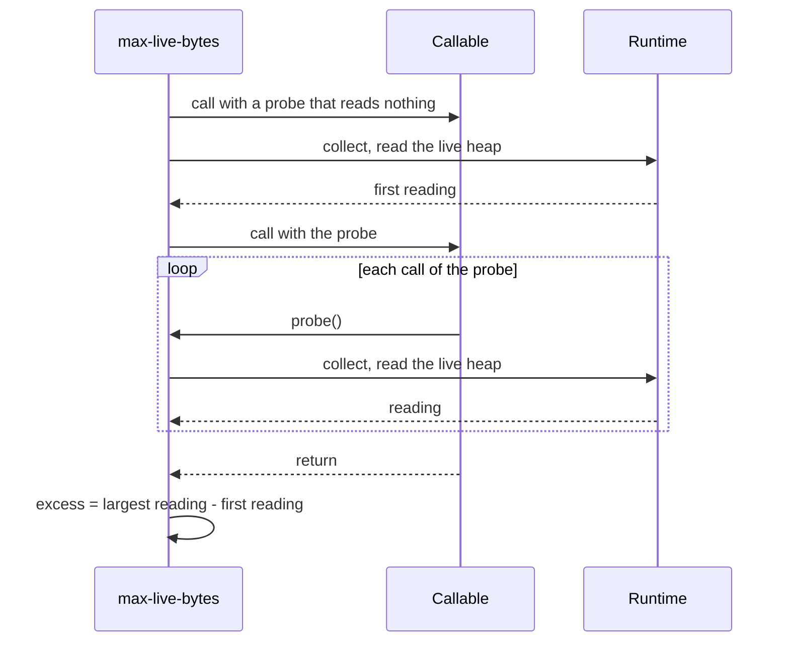

<!--
  ~ Copyright Dokimasia B.V. 2026
  ~ SPDX-License-Identifier: MIT
-->

# RFC-0045: A ceiling on the live heap of a call

## Summary

The allocation assertions count what a call allocates. A streaming filter
and a buffering filter allocate the same bytes and keep different amounts
of memory reachable while they run. This proposal adds the assertion
`max-live-bytes`:

- The callable receives a probe from the assertion. The assertion reads
  the live heap once before the call and again at each call of the probe.
- The assertion fails when the largest reading exceeds the first reading
  by more than a ceiling in bytes, in each of ten runs.
- A run that cannot read the live heap ends the call with a fault, so the
  assertion never passes without a reading.

Go, Python, Rust, TypeScript, Java and Kotlin supply it. Definition 13.2.0
adds the assertion.

## Motivation

### Two filters with equal allocations

A compaction filter of theke streams the entries of one prefix. Its
contract keeps at most `MaxMemoryBytes` between the input and the output
of a filter, so a large prefix never needs the whole prefix in memory. The
conformance kit of theke states that contract for every filter, and assert
has no assertion that checks it.

A filter that buffers its whole input copies every entry once, and so
does a filter that streams it. The two allocate the same bytes, so
`max-allocs`, `max-allocs-with-setup`, `bench-max-allocs` and
`bench-max-bytes` report the same counts for both. The peak of the heap
that each call keeps reachable differs by three orders of magnitude.

A streaming and a buffering filter ran over 1,024 entries of 1 KiB each,
with a probe before the read of each entry. The table states the largest
reading above the heap before the call:

| Runtime | Reading | Streaming filter | Buffering filter | Cost of a reading |
|---|---|---|---|---|
| Go 1.27.3 | `HeapAlloc` after `runtime.GC` | 11,904 B | 1,047,048 B | 67 µs |
| Python 3.11.15 | `tracemalloc` after `gc.collect` | 1,433 B | 1,115,071 B | 243 µs |
| Node 26.12.1 | `heapUsed + arrayBuffers` after a collection | 864 B | 1,245,408 B | 1.0 ms |
| OpenJDK 27.0.1, G1 | heap used after `System.gc` | 7,984 B | 1,068,144 B | 1.2 ms |

A ceiling of 64 KiB passes the streaming filter and fails the buffering
filter in every runtime.

### The check belongs in assert

A caller can write the probe by hand, as theke's kit does in Go. Each
caller then has to know the rules of each runtime. One rule picks the
collection to force. Another picks the counter of the live heap, and a
third lists the settings that make a reading wrong.

Each rule has a trap. Node counts the backing store of a typed array only
in `arrayBuffers`. A reading of `heapUsed` alone reads the buffering filter
at 215 KB to 232 KB. The JVM ignores `System.gc` under
`-XX:+DisableExplicitGC`, and each reading of the JVM probe under that flag
contained the garbage of the call.

A hand-written probe also fails with two numbers and no contract. The
failure of an assertion states the ceiling, the excess and the message.

## Detailed design

### The assertion

```yaml
"max-live-bytes":
  arity: 3
  summary: >
    A callable keeps at most a stated number of bytes of the heap
    reachable at each call of a probe that the assertion hands it. The
    assertion calls it once with a probe that reads nothing to warm it. A
    run then reads the live heap and calls it with a probe that reads the
    live heap at each call. The excess of a run is its largest reading
    less the first reading, or 0. A run whose excess exceeds the ceiling
    is taken again, and the assertion fails when ten runs exceed it. got
    is the smallest excess and probes the calls of the probe in the run of
    that excess.
  detail_fields: [want, got, probes]
```

The arguments are the callable, the ceiling in bytes and the message. An
excess equal to the ceiling passes, as a count equal to its ceiling passes
`max-allocs`.

A run reads the live heap only at a probe. A temporary buffer that the
callable frees before its next probe is not read. The caller puts a probe
where the contract applies, such as before the read of each entry.

A callable that calls the probe in no run ends the call with a fault: "the
callable called the probe 0 times". A pass there would look like a pass of
the ceiling, while no reading compared anything with it.



### A reading in each language

A reading forces a full collection where the runtime has one, and then
reads the bytes of live objects.

| Language | Collection | Reading |
|---|---|---|
| Go | `runtime.GC()` | `runtime.MemStats.HeapAlloc` of `runtime.ReadMemStats` |
| Python | `gc.collect()` | the current size of `tracemalloc.get_traced_memory()` |
| Rust | none: a value is freed when it drops | the bytes that the calling thread allocated less the bytes that it freed, which `CountingAllocator` counts |
| TypeScript | the `gc` that `v8.setFlagsFromString("--expose-gc")` and `vm.runInNewContext("gc")` return | `heapUsed + arrayBuffers` of `process.memoryUsage()` |
| Java, Kotlin | `System.gc()` | `getHeapMemoryUsage().getUsed()` of the `MemoryMXBean` |

Go reads `HeapAlloc` and not the metric `/gc/heap/live:bytes`. After the
same collection the metric read 36,976 B for the streaming filter, against
11,904 B for `HeapAlloc`. A build with the race detector reads 12,304 B
and 1,047,208 B, within 400 B of an ordinary build. A build with
`-gcflags="all=-N -l"` reads 11,984 B and 1,046,856 B. Go checks the
ceiling in every build, while `max-allocs` checks none in those builds
because their counts change.

Python starts `tracemalloc` for the call when it is off, and stops it
afterwards. When the caller traces already, the assertion reads the
caller's trace and leaves it running.

Rust adds a signed counter of live bytes to the thread-local counts of
`CountingAllocator`. `alloc` and `alloc_zeroed` add the size of the layout,
`dealloc` subtracts it, and `realloc` adds the difference of the two sizes.
A reading costs one thread-local read.

TypeScript forces a collection without `--expose-gc` on the command line,
as jest-leak-detector 30.5.1 does. It turns the flag off again when the
process did not set it. A process that starts with `--expose-gc` keeps
its flags, and the assertion calls its global `gc`. A fault that demanded
the flag would make each caller change the configuration of its test
runner. Jest changes the flag at run time in every run with
`--detectLeaks`.

### Faults

A run that cannot read the live heap ends the call with a fault that names
the cause. Each cause is a configuration that the caller can change:

| Language | Fault when |
|---|---|
| Rust | The test binary does not install `CountingAllocator` as its global allocator. The text is the fault of `max_allocs` |
| Java, Kotlin | `-XX:+DisableExplicitGC` or `-XX:+ExplicitGCInvokesConcurrent` is set, or the collector is neither Serial, Parallel nor G1, as `HotSpotDiagnosticMXBean` and the `GarbageCollectorMXBean` names report |
| TypeScript | The runtime is not Node |

The JVM shows why each Java case faults. Under
`-XX:+DisableExplicitGC` each reading contains the garbage of the call:
1,048,576 B for both filters. Under `-XX:+ExplicitGCInvokesConcurrent`
the streaming filter reads 338,576 B. ZGC reports its heap in pages of
2 MiB, so the streaming filter reads 0 B and the buffering filter
2,097,152 B.

A project runs its whole suite in a build such as `-race`, so `max-allocs`
passes without a count in a build that allocates differently. A fault
there would fail every ceiling of the suite. Each cause in the table of
faults is a flag or an allocator of one test binary, and the text of the
fault names it.

### Parallel tests

Go, Python, TypeScript and the JVM read the live heap of the whole process
or the whole isolate. A test that runs beside the call and keeps memory
reachable adds that memory to each reading. Go states the rule that
`MaxAllocs` states: the test that calls `MaxLiveBytes` does not call
`t.Parallel`. Rust reads the counts of the calling thread, so tests on
other threads do not change a reading.

### The languages

```go
// MaxLiveBytes ends the test when fn keeps more than ceiling bytes of the
// heap reachable at a call of probe. It calls fn once to warm it, collects
// and reads the heap, and calls fn again. At each call of probe it collects
// and reads the heap again. A run whose largest reading exceeds the first
// by more than ceiling is taken again, and the assertion fails when ten
// runs exceed it. A fn that calls probe in no run ends the call with a
// fault.
//
// It reads the heap of the whole process, so the test that calls
// MaxLiveBytes does not call t.Parallel.
func MaxLiveBytes(tb TB, fn func(probe func()), ceiling uint64, msg string)
```

```python
def max_live_bytes(
    seat: Seat,
    fn: Callable[[Callable[[], None]], object],
    ceiling: int,
    msg: str,
) -> None:
    """Fail when fn keeps more than ceiling bytes reachable at a probe.

    The assertion collects and reads the traced memory before the call and
    at each call of the probe that fn receives. It fails when ten runs
    exceed the ceiling.
    """
```

```rust
/// Ends the test when `body` keeps more than `ceiling` bytes allocated by
/// its thread at a call of the probe that it receives.
///
/// The test binary installs
/// [`CountingAllocator`](crate::bench::CountingAllocator), and without it
/// the call ends with a fault.
#[track_caller]
pub fn max_live_bytes(seat: &dyn Seat, body: impl FnMut(&dyn Fn()), ceiling: u64, msg: &str);
```

```typescript
/**
 * Fails when fn keeps more than ceiling bytes of the heap and of array
 * buffers reachable at a call of probe. fn may return a promise, and the
 * returned promise settles when every run has ended.
 */
export function maxLiveBytes(
  seat: Seat,
  fn: (probe: () => void) => void | Promise<void>,
  ceiling: number,
  msg: string,
): Promise<void>;
```

A Go caller states the contract of a filter like this. `filter` and
`entries` are the caller's own:

```go
assert.MaxLiveBytes(t, func(probe func()) {
	for e := range filter(entries(1024, 1<<10)) {
		probe()
		sink = e
	}
}, 64<<10, "the filter keeps at most 64 KiB of a prefix")
```

### Names

| Id | Go | Python | Rust | TypeScript | Java | Kotlin |
|---|---|---|---|---|---|---|
| `max-live-bytes` | `MaxLiveBytes` | `max_live_bytes` | `max_live_bytes` | `maxLiveBytes` | `maxLiveBytes` | `maxLiveBytes` |

The assertion is in the root namespace, beside `max-allocs`.

### Conformance

The callable and its probe are code, and a reading depends on the runtime,
so no corpus case can state the assertion. The definition lists it with
`max-allocs` among the assertions that only the completeness gate checks.
Each implementation tests the assertion itself:

- A callable that streams passes a ceiling that a callable that buffers
  fails.
- A failure reports the ceiling, the smallest excess and the probes of its
  run.
- A callable that never calls the probe ends the call with a fault.
- Each fault in the table of faults, where the language has one.

### Version

Adding an assertion is a minor version. Definition 13.2.0 adds
`max-live-bytes`, and every overlay extends 13.2.0.

## Alternatives considered

### A. The peak that the runtime keeps

Python's `tracemalloc` and dhat-rs keep the peak of the traced memory. The
assertion would reset the peak, call the callable once without a probe and
read the peak.

**Why not:** Go, Node and the JVM do not keep a peak of live bytes, because
their collectors learn which objects are live only during a collection.
Their counters between two collections include the garbage of the call.
The peak of Python and Rust also includes every temporary buffer, and
those two languages would fail callables that Go and the JVM pass. With a
probe the six languages read the heap at the same points of the call.

### B. A reading after the call alone

The assertion would read the heap after the callable returns.

**Why not:** a buffering filter frees its buffer before it returns. Both
filters then read the same heap after the call. That reading measures what
a call leaks. The ceiling bounds what a call keeps while it runs.

### C. A sampler on another thread

A thread would read the heap at an interval while the callable runs. The
callable would take no probe.

**Why not:** a forced collection stops the callable wherever the interval
ends, and two runs read different peaks. Node runs the JavaScript of an
isolate on one thread, and a second thread cannot read the heap of the
isolate while the callable runs. A probe makes the readings repeatable.

### D. A pass without a reading

The assertion would pass without a reading where it cannot read the heap,
as `max-allocs` passes without a count in a build that allocates
differently. A helper like `allocs-checked` would report it.

**Why not:** the settings that stop a reading are settings of one test
binary, such as `-XX:+DisableExplicitGC` or a missing global allocator. A
fault names the setting at the call. A pass would also need a second
helper in the naming table. Without a call of that helper, the caller
keeps a check that cannot fail.

### E. A ceiling on the bytes that a call allocates

A test form of `bench-max-bytes` would bound the bytes that a call
allocates.

**Why not:** the two filters allocate the same bytes. The probe of the
issue measured 1,048,576 B for each in Go. A ceiling on the bytes
allocated bounds the work of a call. It cannot tell how much of that
memory is reachable at one time.

## Drawbacks

- A reading costs a full collection: 61 to 80 µs in Go, 243 to 256 µs in
  Python, 0.9 to 1.0 ms in Node and 1.2 to 1.7 ms in the JVM, measured by
  the probes of the motivation. A collection scans the
  whole live heap, so its cost grows with the heap of the test process. A
  callable with 1,024 probes takes about 1 s per run in Node, and a
  failing call takes ten runs.
- Go, Python, TypeScript and the JVM read the heap of the whole process or
  isolate. A Go test that calls `MaxLiveBytes` cannot run in parallel with
  other tests. In Python a thread that runs beside the call adds to the
  readings.
- The readings contain the bookkeeping of each runtime: Go read 11,904 B
  for a filter that keeps one entry of 1 KiB. A ceiling needs headroom for
  it, and the headroom differs between runtimes.
- Rust reads the bytes of the calling thread. A callable that hands its
  buffers to a worker thread keeps memory that no reading counts.
- Java and Kotlin fault under ZGC, Shenandoah and two common flags of the
  JVM.
- TypeScript changes a V8 flag at run time. Node documents that a change
  through `v8.setFlagsFromString` after the start of the VM can behave
  unpredictably, crash or lose data, or have no effect.
- Rust's `CountingAllocator` gains one counter and one subtraction in
  `dealloc`.
- The naming table gains one row, and each language gains one assertion
  and its specs.

## Unresolved and future work

- A property form, such as `prop-max-live-bytes`, is not proposed here.
- A ceiling on what a call leaks, read after it returns, is not proposed
  here.

## References

| What | Where |
|---|---|
| The issue | <https://github.com/dokimasia/assert-spec/issues/26> |
| `runtime.GC` and `/gc/heap/live:bytes`, Go 1.27.3 | `src/runtime/mgc.go`, `src/runtime/metrics/description.go` |
| `tracemalloc.get_traced_memory`, CPython 3.11 | <https://docs.python.org/3.11/library/tracemalloc.html> |
| A collection forced in a running Node process, under `--detectLeaks` | `jest-leak-detector` 30.5.1, `build/index.js`, lines 109 to 116 |
| `v8.setFlagsFromString` and `process.memoryUsage().arrayBuffers`, Node 26.12.1 | `@types/node`, `v8.d.ts` and `process.d.ts` |
| `System.gc` under G1, ZGC, `-XX:+DisableExplicitGC` and `-XX:+ExplicitGCInvokesConcurrent` | OpenJDK 27.0.1, measured by the JVM probe below |
| `HeapStats` with `curr_bytes` and `max_bytes` | <https://docs.rs/dhat/latest/dhat/struct.HeapStats.html> |
| The probes of the readings, run on 2026-10-28 | Four programs that run a streaming and a buffering filter over 1,024 entries of 1 KiB in Go, Python, Node and the JVM |
