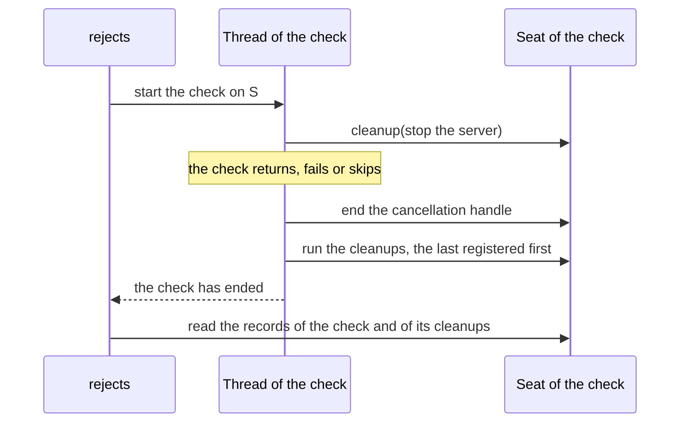

<!--
  ~ Copyright Dokimasia B.V. 2026
  ~ SPDX-License-Identifier: MIT
-->

# RFC-0047: Cleanups on a seat

## Summary

A helper that takes a seat cannot register a function that runs when the
test ends. In Go, `assert.TB` has `Helper`, `Fatalf` and `Errorf`.
`*testing.T`, `*testing.B`, `*testing.F` and `*prop.Case` have `Cleanup`,
but a `Recorder` and the seat that `Rejects` hands its check have none.
This proposal adds the seat member `seat.cleanup(function)`:

- The seat of a test runs its cleanups when the test ends, and a case runs
  them when the case ends, as both do today.
- The seat that `rejects` hands its check, and the seat of each attempt of
  `eventually`, run their cleanups when the body ends. They run them before
  the assertion returns.
- The recorder runs its cleanups at a new member, `run-cleanups`.
- In Go, Python and TypeScript, the helper `cleanup` registers a function
  on any seat. On a seat without the member it ends the call with a fault,
  and the function does not run.

Definition 13.4.0 adds the member, the helper and the member of the
recorder.

## Motivation

### A helper cannot release what it starts

Helpers take the seat, so that one helper serves the seat of a test, a
case of a property, a recorder and the seat of a check under `rejects`.
Some of them start a server, a process or a directory, which they also
have to release when the test ends. The seat has no member that registers
the release.

In Go, a helper that takes `assert.TB` and calls `Cleanup` does not
compile:

```text
helpers_test.go:640:5: tb.Cleanup undefined (type assert.TB has no field or method Cleanup)
```

In the code bases that we read, 17 Go files in three of them declare an
interface of their own that adds `Cleanup(f func())` to `assert.TB`. A
helper that takes such an interface accepts `*testing.T` and `*prop.Case`.
The compiler refuses a `Recorder` and the seat that `Rejects` hands its
check. A test of the helper cannot use a recorder, and a check under
`Rejects` cannot call the helper.

### The libraries look for the member in code of their own

Each library looks for a cleanup on a seat where it needs one, and treats a
seat without one in its own way:

| Library | Code | A seat without cleanups |
|---|---|---|
| Go | The claim of a property on the entries of its store | The property claims nothing |
| Go | `files.Workspace` | It takes a `testing.TB`, so it refuses every other seat |
| Python | `files.workspace` | The call ends with a fault |
| Python | The claim of a property on its store | The property claims nothing |
| TypeScript | `files.workspace` | It takes `Seat & Cleanups`, so the compiler refuses the seat |
| TypeScript | The claim of a property on its store | The property claims nothing |
| Rust | `files::workspace` | It returns a guard that removes the directory when the guard drops |

The collectors of Python and TypeScript have a member `cleanup`, which the
definition does not name. A conformance kit that wraps the seat of a check
repeats the search as well. It registers a function with a seat that has
`Cleanup`, and otherwise runs the function itself when the check ends.

## Detailed design

### The member

```text
Seat
  helper()
  fail(message)
  record(message)
  report(failure, aborting)
  report-fault(fault, ending)
  observe-call(call)
  skip(reason)
  cleanup(function)
  clock() -> Clock
  cancellation() -> cancellation handle
```

`cleanup(function)` registers a function without arguments. The seat runs
the function when its test, its case or its body ends. Every seat that runs
cleanups follows the rules of the cleanups of a case:

- It runs the last registered first.
- It runs them however the test or the body ended: it returned, it failed,
  it skipped or it raised an error.
- It ends its cancellation handle before the first cleanup runs.
- A failure in a cleanup is a failure of the seat, as a failure in the body
  is. The later cleanups still run.
- A cleanup that another cleanup registers runs in the same pass.
- It accepts a registration from any thread, as every seat is safe for
  concurrent use.

A case is a seat, so `case.cleanup` is the case's `seat.cleanup`. The
cleanups of a case keep their meaning.

### The cleanups of each seat

| Seat | Runs its cleanups |
|---|---|
| The seat of a test of the platform | When the test ends |
| A case | When the case ends |
| The seat that `rejects` hands its check | When the check ends, before `rejects` returns |
| The seat of an attempt of `eventually` | When the attempt ends, before the next attempt starts |
| The recorder | At `run-cleanups` |
| `Standard`, and any other seat without the member | Never. The helper `cleanup` ends the call with a fault |

The seat of a test runs its cleanups through the platform or through the
fixture that hands the test its seat:

| Language | Seat of a test | When it runs its cleanups |
|---|---|---|
| Go | `*testing.T`, `*testing.B` and `*testing.F` | When the test and its subtests end. `testing.TB` declares `Cleanup` since Go 1.14 |
| Python | The collector of the fixture `seat` | When the call of the test ends, in the hook of the plugin |
| TypeScript | The collector of the fixture of `@dokimi/assert/vitest` | When the fixture ends |
| Rust | `Collector` | When the collector drops at the end of the test, also while the test panics |
| Java, Kotlin | `SeatExtension` | After the test runs, in `afterTestExecution` |

A Rust collector that drops while its test panics cannot fail the test a
second time. It writes a cleanup that panics then to the standard error.

The seat of a test reports an error that a cleanup raises as a failure of
the test. The collectors of Python and TypeScript keep it as they do today,
as the failure `a cleanup failed:` followed by the text of the error.

### The cleanups of a body

`rejects` hands its check a seat of its own, and `eventually` hands one to
each attempt. The seat of the body runs its cleanups on the thread of the
body, once the body has ended:



- The records of the assertions in a cleanup are records of the body's
  run, as the records of the assertions in the body are.
- A failure in a cleanup of the check fails the check. `rejects` then
  passes, and it returns the record of the cleanup with the records of the
  body.
- A failure in a cleanup of an attempt fails the attempt, and `eventually`
  tries again.
- An error that a cleanup raises leaves the assertion in the same way as an
  error that the body raises, once the later cleanups have run.
- A cleanup that arrives after the seat ran its cleanups runs at once, on
  the thread that registers it. The cancellation handle of an ended body is
  already cancelled for the same reason.
- The allocation ceilings of `rejects` and `eventually` apply to a body
  that does not register a cleanup.

### The recorder

`run-cleanups()` runs the cleanups that the recorder keeps, the last
registered first, and forgets them. A cleanup that a cleanup registers runs
before the call returns. A cleanup that arrives after the call waits for
the next call.

- A failure in a cleanup is a failure of the recorder, as every failure
  that the recorder receives is.
- The recorder keeps an error that a cleanup raises as the failure `a
  cleanup failed:` followed by the text of the error. Go does not recover
  the panic of a cleanup, as it does not recover the panic of a body.
- A recorder does not run a cleanup until a test calls `run-cleanups`.
  Python's fixture `recorder` calls it when the test ends. A Rust recorder
  runs the remaining cleanups when it drops. A Java recorder is an
  `AutoCloseable`, so try-with-resources runs them.

A test of a helper runs the helper's cleanups at a point of its own, and
then checks their effect:

```go
func TestWitnessStopsItsServer(t *testing.T) {
	rec := assert.NewRecorder()
	srv := witness(rec)
	rec.RunCleanups()

	_, err := http.Get(srv.URL)
	assert.Error(t, err, "the cleanup of witness stops its server")
}
```

A Go test that does not check the effect registers the run with its own
test, through `t.Cleanup(rec.RunCleanups)`.

### The helper

A seat may lack the member in Go, Python and TypeScript. The helper
`cleanup(seat, function)` registers the function through the member of the
seat. On a seat without the member it ends the call with a fault, and the
function does not run. A test whose helper cannot release what it starts
then stops at that helper.

Rust, Java and Kotlin give the member a default on the seat. The default
ends the call with the same fault, so a helper calls the member.

```go
// Cleanup registers f to run when the test of tb ends. It calls the method
// Cleanup of tb, or of the first seat of the chain of tb that has the
// method, as [TB] states. *testing.T, *testing.B, *testing.F, *prop.Case,
// a [Recorder], and the seats of the bodies of [Rejects] and [Eventually]
// have the method. A chain without the method ends the call with a fault,
// and f does not run.
//
// A helper that takes a TB registers the release of what it starts:
//
//	func witness(tb assert.TB) *httptest.Server {
//	    tb.Helper()
//	    srv := httptest.NewServer(newWitness())
//	    assert.Cleanup(tb, srv.Close)
//	    return srv
//	}
func Cleanup(tb TB, f func())

// Cleanup registers f to run at [Recorder.RunCleanups].
func (r *Recorder) Cleanup(f func())

// RunCleanups runs the functions that Cleanup registered, the last
// registered first, and forgets them. A function that a function registers
// runs before RunCleanups returns.
func (r *Recorder) RunCleanups()
```

```python
def cleanup(seat: Seat, fn: Callable[[], object]) -> None:
    """Register fn to run when the test, the case or the body of seat ends.

    The call ends with a fault on a seat without the member cleanup, and
    fn does not run.
    """


class Recorder:
    def cleanup(self, fn: Callable[[], object]) -> None: ...
    def run_cleanups(self) -> None: ...
```

```rust
pub trait Seat: Send + Sync {
    /// Registers `f` to run when the test, the case or the body of the seat
    /// ends. The default ends the call with a fault, and `f` does not run.
    fn cleanup(&self, f: Box<dyn FnOnce() + Send>) { ... }
}

impl Recorder {
    /// Runs the cleanups that the recorder keeps, the last registered first,
    /// and forgets them. The drop of the recorder runs the remaining ones.
    pub fn run_cleanups(&self) { ... }
}
```

```typescript
interface Seat {
  /** Registers fn to run when the test, the case or the body of the seat ends. */
  cleanup?(fn: () => void | Promise<void>): void;
}

/** Registers fn on seat, and ends the call with a fault on a seat without the member. */
export function cleanup(seat: Seat, fn: () => void | Promise<void>): void;

class Recorder {
  cleanup(fn: () => void | Promise<void>): void;
  runCleanups(): Promise<void>;
}
```

```java
public interface Seat {
  /// Registers fn to run when the test, the case or the body of the seat
  /// ends. The default ends the call with a fault, and fn does not run.
  default void cleanup(Runnable fn) { ... }
}

public final class Recorder implements Seat, Reporter, Clocked, AutoCloseable {
  @Override
  public void cleanup(Runnable fn) { ... }

  /// Runs the cleanups that the recorder keeps, the last registered first.
  @Override
  public void close() { ... }
}
```

### Asynchronous cleanups

Python and TypeScript accept a cleanup that returns an awaitable or a
promise, as their cases do. A seat awaits such a cleanup before the next
cleanup runs:

- TypeScript awaits it on every seat. `runCleanups` returns a promise, and
  the fixture of `@dokimi/assert/vitest` awaits the cleanups of the
  collector.
- Python awaits a cleanup of a body on the event loop of the assertion call
  that ran the body. It awaits a cleanup of the collector or the recorder
  on an event loop of its own, as it runs an awaitable body.

Go, Rust and Java take a function that returns nothing.

### Names

| Id | Go | Python | Rust | TypeScript | Java | Kotlin |
|---|---|---|---|---|---|---|
| `seat.cleanup` | `Cleanup` | `cleanup` | `cleanup` | `cleanup` | `cleanup` | `cleanup` |
| `cleanup` | `Cleanup` | `cleanup` | | `cleanup` | | |
| `recorder-seat.run-cleanups` | `RunCleanups` | `run_cleanups` | `run_cleanups` | `runCleanups` | `close` | `close` |

- Go names the member `Cleanup`, which `testing.TB` declares. The helper
  finds the method along the seats that `Unwrap` returns, as `Context`
  finds `Context`. Go does not declare an interface for the member, as it
  does not declare one for `Skipf`.
- Python and TypeScript have the member as an optional member of the seat,
  as they have `observe-call`.
- Rust, Java and Kotlin give the member a default on the seat. A helper
  calls the member, so the three decline the helper `cleanup`.
- Java and Kotlin name `run-cleanups` `close`. Their recorder is an
  `AutoCloseable`, which try-with-resources and Kotlin's `use` close.

### Conformance

A seat is an input of a test, so no vector pins the member. Each language
tests these behaviours in its own tests:

- Each seat runs each cleanup once, the last registered first. It runs
  them also when the test or the body failed, skipped or raised an error.
- A seat ends its cancellation handle before its first cleanup runs.
- A cleanup that another cleanup registers runs in the same pass.
- A failure in a cleanup fails the test, the case, the check or the
  attempt, and the later cleanups still run.
- `rejects` runs the cleanups of its check on the thread of the check,
  before it returns. It returns the records of the cleanups with the
  records of the check.
- `eventually` runs the cleanups of an attempt before the next attempt
  starts.
- `run-cleanups` runs the cleanups of the recorder and forgets them. A
  second call runs only the cleanups that arrived after the first.
- The helper ends the call with a fault on a seat without the member, and
  the function does not run.
- In Go, the helper finds the member along the seats that `Unwrap` returns.

### Version

The member, the helper and the member of the recorder add names. They do
not change the meaning of an existing name. Definition 13.4.0 adds the
three rows, and every overlay extends 13.4.0. The overlays of Rust, Java
and Kotlin decline the helper.

## Alternatives considered

### A. `Cleanup` in Go's `TB`

`assert.TB` would declare `Cleanup(f func())`, which `*testing.T`,
`*testing.B` and `*testing.F` already have.

**Why not:** every seat would have to implement it, also a seat that has no
end of its own, such as the seat of a generated check body. Go has the
handle of a seat and its skip as methods that a seat may lack for the same
reason.

### B. Run the function at once on a seat without cleanups

**Why not:** the helper would release what it started before its caller
used it. The test would then fail for a reason that it does not state.

### C. Register nothing on a seat without cleanups

On a seat without cleanups, the helper would drop the function, as the
claim of a property on its store drops it today.

**Why not:** the server, the process or the directory of the helper would
remain after the test ends, and the test would pass. A property that claims
nothing still runs its cases. A helper whose release never runs leaves a
port, a process or a directory behind for each test.

### D. The recorder passes its cleanups to its test

A recorder that a builder gave a test, such as `Recorder.WithTest` in Go,
would register each cleanup with that test.

**Why not:** a test of a helper runs the helper's cleanups at a point of
its own, so that it can check their effect before the test ends. A
recorder without a test would still need a rule of its own.

### E. A body passes its cleanups to the seat of the assertion

The seat of a check and the seat of an attempt would register each cleanup
with the seat of `rejects` or `eventually`. The cleanups would run when the
test ends.

**Why not:** the resources of a body would remain after the body ends.
`eventually` runs its body once for each interval until it passes, and the
resources of every attempt would accumulate until the test ends. The
cancellation handle of a body ends with the body, and its cleanups end with
it for the same reason.

### F. A scope beside the seat

A helper would take a scope beside the seat, such as Python's
`contextlib.ExitStack`.

**Why not:** every helper of a test kit would grow an argument, and every
caller would pass a value that the seat already has. The seat is the one
value that a test passes to each helper.

### G. Synchronous cleanups alone

Python and TypeScript would take a function that returns nothing, as Go
does.

**Why not:** a server or a connection in either language closes
asynchronously, and the cases of both already await a cleanup. vitest's
`onTestFinished` and the `addAsyncCleanup` of Python's `unittest` await
one as well.

## Drawbacks

- The seat gains a member in six languages, and the recorder gains two.
  Go, Python and TypeScript gain a helper. The naming table gains three
  rows.
- The seat of a body in each language keeps a list of cleanups and runs it
  when the body ends.
- Code that looks for the member now finds it on a recorder and on the seat
  of a body. That code is the claim of a property on its store in Go,
  Python and TypeScript, and the workspace of Python and TypeScript. On a
  recorder whose cleanups never run, such a claim and such a directory
  remain until the process ends.
- A test that hands a recorder to code that registers cleanups has to run
  them. Python's fixture, the drop of a Rust recorder and Java's
  try-with-resources run them without a call.
- Python runs an awaitable cleanup of the collector and the recorder on an
  event loop of its own. Such a cleanup cannot await an object of the loop
  of an assertion call, because that loop has closed.
- A Rust collector cannot fail a test a second time while the test panics,
  so a cleanup that panics then only writes to the standard error.

## References

| What | Where |
|---|---|
| The issue | <https://github.com/dokimasia/assert-spec/issues/28> |
| `Cleanup` of `testing.TB`, added in Go 1.14 | `api/go1.14.txt`, and `src/testing/testing.go` in Go 1.27.3 |
| The cleanups of a case | RFC-0010 |
| The cancellation handle of a seat, and Go's `Context` | RFC-0029 |
| The member `observe-call` | RFC-0044 |
| `addCleanup` and `doCleanups` of `unittest`, and its `addAsyncCleanup` | `Lib/unittest/case.py` and `Lib/unittest/async_case.py` in Python 3.14 |
| `contextlib.ExitStack` | `Lib/contextlib.py` in Python 3.14 |
| vitest's `onTestFinished`, which runs in the reverse order of registration and awaits a promise | The declaration of `onTestFinished` in `@vitest/runner` 4.1.12 |
