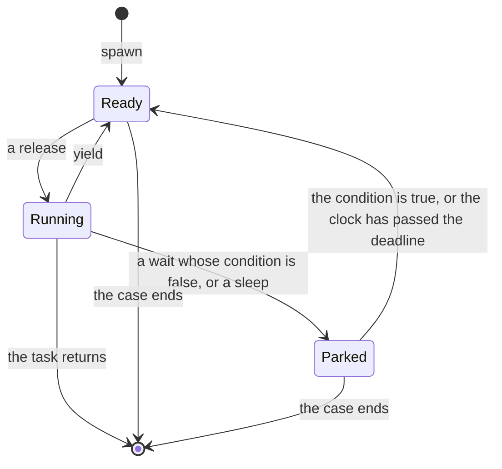

<!--
  ~ Copyright Dokimasia B.V. 2026
  ~ SPDX-License-Identifier: MIT
-->

# RFC-0056: Tasks that wait and sleep under the task scheduler

## Summary

A task of the task scheduler can yield and end, and it cannot wait. A task that waits for a condition or for time yields in a loop, so it remains ready while it waits, and `run` does not return. This proposal adds three members to the scheduler and one option:

- `wait(condition)` parks the running task until the condition is true. A parked task is not ready, so `run` returns while the task waits.
- `clock()` returns the clock of the scheduler. Its `sleep` parks the running task until the clock has passed the duration.
- `advance(duration)` moves the clock of the scheduler from deadline to deadline, and releases the tasks of each deadline at the time of that deadline.
- The option `max-releases` fails a case whose `run` or `advance` releases 1,000,000 tasks, by default, while a task is still ready.

Definition 16.0.0 adds the four rows, five machine subjects and six vectors.

## Motivation

### A task that waits for the body keeps `run` from returning

`run` releases one ready task at a time until no task is ready, and a task that yields becomes ready again. The tasks of a subject often wait for a change that the body makes in a later step. A flusher waits for a write, a call waits for the reply of a simulated network, and a writer waits for a disk that a fault blocks. With `yield` alone, such a task waits in a loop:

```go
for !store.Dirty() {
	s.Yield()
}
```

The task remains ready while it waits, so `run` releases it again and again and does not return. The body then cannot take the step that ends the wait:

- Under `uniform`, each release records a choice. The case makes more choices than `max-choices` allows, 8,192 by default, and the run rejects the case.
- Under `pct`, a release does not record a choice. The ready task with the highest priority runs, and a task that yields keeps its priority, so the loop does not end.

A task that waits for another task has the same cost under `pct`. A waiting task with a higher priority than the task that it waits for runs until a change point lowers it.

### A task that sleeps has no clock that the scheduler moves

A controlled clock moves only when a test advances it, and its `sleep` blocks the calling thread until then. A released task runs alone until it yields or ends. So a task that sleeps on a controlled clock never ends its turn: `run` waits for the turn to end, and the body that would advance the clock waits for `run` to return. A subject with a timer cannot run as tasks, such as a store that flushes after 10 ms or a client that retries with a backoff.

### The cost of a release

On assert-go 5c5b841 and Go 1.27.3, two tasks that yield 1,000 times each took 660 ns per release under `uniform`, and one such task took 864 ns per release. Under `pct(3)`, two tasks that yield 100,000 times each took 191 ns per release, and one such task took 173 ns. So a run of 1,000,000 releases under `pct` takes about 0.19 s.

### Prior art

| Tool | How time moves | A bound on one run |
|---|---|---|
| Go's `testing/synctest` | Each bubble has its own clock, which starts at midnight UTC 2000-01-01. Once every goroutine of the bubble is durably blocked, time advances to the next time that unblocks a goroutine | None |
| kotlinx-coroutines-test | Virtual time starts at 0 ms. `advanceTimeBy` runs the tasks that are due before the end time, each at its own time, and sets the time to the end time | None |
| tokio | `time::advance` moves the clock in one jump, and the sleeps that it passes complete "at the same time" in any order. With the clock paused, the runtime moves the clock to the next timer once no work remains | None |
| loom | None | `max_branches`, 1,000 by default. A model past it panics: "This is often caused by an algorithm requiring the processor to make progress, e.g. spin locks." |
| Shuttle | None | `max_steps`, `MaxSteps::FailAfter(1_000_000)` by default, which fails the test with a panic |

## Detailed design

### The members

```text
Scheduler
  wait(condition)
      Parks the running task until condition returns true. A wait whose
      condition returns true at the call returns at once.
  clock() -> Clock
      The clock of the scheduler. It starts at midnight UTC 2000-01-01, and
      only advance moves it. Its sleep parks the running task until the clock
      has passed the duration.
  advance(duration)
      Releases tasks as run does, and moves the clock to each deadline of a
      parked sleep up to duration from the time of the call. Returns once no
      task is ready at that time.

new(case, strategy, options)
  max-releases(n)    the most releases of one run or one advance; 1,000,000
```

A run without a wait and without a sleep releases its tasks as it does today, because `spawn`, `yield` and `run` keep their meaning.

### The states of a task



### Woken tasks

The scheduler checks its parked tasks at the start of each `run` and each `advance`, after each turn, and after each move of its clock. It makes these tasks ready, after every ready task:

1. Each sleeping task whose deadline the clock has passed, in the order of the deadlines. Tasks with one deadline join in the order of their sleeps.
2. Each waiting task whose condition returns true, in the order of the waits.

The scheduler also follows these rules:

- A task that yields joins the ready tasks before the tasks that the end of its turn makes ready.
- A task keeps its priority and its level under `pct` through a wait and a sleep, as it keeps them through a yield.
- The scheduler calls each condition between two turns, on the thread that calls `run` or `advance`. A condition reads the state of the subject and does not change it. A condition that raises an error fails the case, as a task that raises does.
- A wait outside a task, on the thread that runs the body, returns at once when its condition is true. It fails the test when its condition is false, because no task can run while the body waits.

### The clock of the scheduler

The clock is a `clock` of the definition, with `now` and `sleep`:

- Every scheduler has a clock of its own, which starts at midnight UTC 2000-01-01, as the clock of a `testing/synctest` bubble does. Only the `advance` of its scheduler moves it.
- A sleep of a positive duration inside a task parks the task. Its deadline is the time of the clock at the sleep plus the duration. The task becomes ready once the clock reads the deadline or a later time.
- A sleep of zero or less returns at once, as the sleep of a controlled clock does.
- A sleep of a positive duration outside a task fails the test, because only the body can advance the clock.

The tasks of a case on one worker do not read the time of a case on another worker, because each scheduler has a clock of its own. A replay of a case reads the same instants as the case, since the clock of its scheduler starts at the same instant.

### Advance

`advance(duration)` runs in four steps:

1. Under `pct`, it makes the change points of a run. It counts its releases from 0 over all its steps.
2. It releases one ready task at a time, as `run` does, until no task is ready.
3. It moves the clock to the earliest deadline of a parked sleep. When no sleep is parked, or the earliest deadline is after the end time, it moves the clock to the end time instead. The end time is the time of the clock at the call plus the duration. The move makes ready the tasks of that deadline and each waiting task whose condition is now true.
4. It returns when the clock reads the end time and no task is ready. Otherwise it continues at step 2.

A task that a deadline wakes reads the time of its own deadline. A task that sleeps again measures its next deadline from there. A sleep whose deadline is the end time ends within the advance.

A duration of zero or less moves the clock by nothing, as the advance of a controlled clock does. Such an advance releases tasks as `run` does. A task that calls `advance` fails the test, as a task that calls `run` does.

### The release limit

`max-releases(n)` takes a positive int, and the last `max-releases` of a call of `new` applies. Each language refuses a count below 1 where it builds the option, and Go panics.

A run or an advance that has released `n` tasks while a task is still ready ends every task of the scheduler. It then fails the case as the `fail` of the case fails it, with this message:

```text
the task scheduler released 1000000 tasks in one run, and a task is still ready
```

The failure is a record without an assertion, and its message states `n` in decimal digits. Its identity is the innermost frame in the caller's code, and the case shrinks as every failing case does. The counterexample then lists the steps that keep a task ready.

The default of 1,000,000 is the default of Shuttle, and it costs about 0.19 s under `pct`. Under `uniform` each release records a choice. So a case of `uniform` makes more choices than `max-choices` allows long before it releases 1,000,000 tasks, unless the run raises `max-choices`.

### Tasks at the end of a case

When its case ends, the scheduler ends every task that has not returned. A parked task ends there too, as a task that waits for its release does. Such a task does not return from its wait or its sleep. Each language ends the task as its runtime allows, and Go ends the goroutine of the task.

### The concurrent section of a machine

Once `run` returns, a concurrent section of `steps` ends, also while the task of a client waits or sleeps. Such a client leaves its call open, and a drain action can complete it. The check after the section reads an open call as a call without a completion.

### The languages

```go
// Wait parks the running task until cond returns true. It returns at once
// when cond returns true at the call. The scheduler calls cond between two
// turns, on the goroutine that calls Run or Advance. Outside a task, on the
// goroutine that runs the body, Wait returns at once when cond returns true.
//
// # Panics
//
// Wait panics outside a task when cond returns false.
func (s *Scheduler) Wait(cond func() bool)

// Clock returns the clock of the scheduler. It reads midnight UTC 2000-01-01
// until Advance moves it. Its Sleep parks the running task until the clock
// has passed the duration.
func (s *Scheduler) Clock() assert.Clock

// Advance releases the ready tasks as Run does, and moves the clock to each
// deadline of a parked sleep up to d from now, in order. The tasks of each
// deadline run at the time of that deadline. Advance returns once the clock
// reads its end time and no task is ready.
//
// # Panics
//
// Advance panics when a task calls it on its own scheduler.
func (s *Scheduler) Advance(d time.Duration)

// MaxReleases sets the most tasks that one Run or one Advance releases. It
// panics for n below 1.
func MaxReleases(n int) SchedulerOption

// NewScheduler returns a scheduler of the case c that releases tasks by
// strategy, under the options opts.
func NewScheduler(c *prop.Case, strategy Strategy, opts ...SchedulerOption) *Scheduler
```

An asyncio task parks on an `asyncio.Event` or an `asyncio.Condition`, and a coroutine parks on a `Channel` or a `Mutex`, at a point that the scheduler sees. So Python and Kotlin decline `wait`, as they decline `yield`. A task of the two languages sleeps with `asyncio.sleep` and with `delay`, which park the task on the clock of the event loop and of the dispatcher. That clock is the clock of the scheduler.

`Object.wait` is a final method of each Java object, so Java names `wait` as `await`, as the `Condition` of `java.util.concurrent.locks` names its wait.

### Names

| Id | Go | Python | Rust | TypeScript | Java | Kotlin |
|---|---|---|---|---|---|---|
| `scheduler.wait` | `Wait` | | `wait` | `wait` | `await` | |
| `scheduler.clock` | `Clock` | `clock` | `clock` | `clock` | `clock` | `clock` |
| `scheduler.advance` | `Advance` | `advance` | `advance` | `advance` | `advance` | `advance` |
| `scheduler.max-releases` | `stateful.MaxReleases` | `stateful.max_releases` | `stateful::max_releases` | `stateful.maxReleases` | `Stateful.maxReleases` | `Stateful.maxReleases` |

That is four rows and 22 names.

### What is fixed and what is free

| Tier | What it covers here |
|---|---|
| Fixed | When a parked task becomes ready, and where it joins the ready tasks. That a task keeps its priority and its level through a wait and a sleep. The clock of each scheduler, its start, and that only `advance` moves it. The deadline of a sleep, and that a sleep of zero or less returns at once. The four steps of `advance`. The release limit, its default, its message and its failure. That a parked task does not return when its case ends |
| Named | The four rows |
| Declared | That Python and Kotlin decline `wait` |
| Free | How a language ends a parked task, and how Python and Kotlin connect the clock of the scheduler to their event loop and their dispatcher |

### Conformance

Five subjects join the machines section of `assertions.yaml`, and each of them spawns its tasks on a scheduler of the case with the strategy of the setup. The clients of a concurrent section run on the same scheduler.

| Subject | What it does | What the case states |
|---|---|---|
| `register-flushes-in-two-parts` | A register of a buffer and a durable value. A flusher task waits until the buffer is set, takes the value and clears the buffer, yields, and then sets the durable value. A read returns the buffer when it is set, and the durable value otherwise | Two clients under `uniform`. The minimal case writes on client 0 before the concurrent section and reads on client 1 within it, and the read returns null |
| `register-flushes` | The register with a flusher that sets the durable value before it clears the buffer | Passes with two clients |
| `ticker-skips-its-first-tick` | A ticker task sleeps 4 ms and adds one to its count, four times, and it skips the first addition. The action `advance` advances the scheduler by an integer of milliseconds in [0, 10], and `read` returns the count | The minimal steps advance 4 ms and read 0, where the spec reads 1 |
| `ticker` | The ticker without the skip | Passes. An advance in one jump fails it, because a tick then measures from the end time of the advance |
| `spins-until-a-flag` | A task that yields until a flag is set. No action sets the flag | Under a `max-releases` of 50, the minimal case is one step, and its failure has the message of the limit |

These vectors pin the members:

- `register-flushes-in-two-parts/a-read-between-the-two-parts-of-a-flush-returns-null`
- `register-flushes-in-two-parts/keeps-the-priority-of-a-woken-task-under-pct-3`, the same subject under `pct(3)`
- `register-flushes/passes-with-two-clients`
- `ticker-skips-its-first-tick/an-advance-of-4-ms-and-a-read-return-0`, under `pct(1)`
- `ticker/passes-when-each-tick-runs-at-its-deadline`, under `pct(1)`
- `spins-until-a-flag/fails-the-case-at-the-release-limit`, under the setup `max-releases: 50`

The ticker vectors run under `pct(1)`, whose releases do not record a choice. The choices of a case then do not depend on the deadlines that an advance passes, so the shrink lowers the milliseconds of an advance alone. The setup of a machines vector gains the key `max-releases`. A vector cannot state a fault or the end of a case. Each language tests these behaviours in its own tests:

- A wait outside a task returns at once when its condition is true, and fails the test when it is false.
- A sleep of a positive duration outside a task fails the test, and a sleep of zero or less returns at once.
- A task that calls `advance` fails the test.
- A condition that raises an error fails the case.
- A parked task ends with its case, and does not return from its wait or its sleep.
- A count below 1 for `max-releases` is refused.

### Version

The members and the option add names, and a run whose every `run` and `advance` releases fewer than 1,000,000 tasks is unchanged. Every stored case of such a run replays unchanged. A run that released more tasks in one call now fails. RFC-0010 makes a change to an outcome a major version. Definition 16.0.0 adds the four rows, and every overlay extends 16.0.0.

## Alternatives considered

### A. A wait as a loop of yields

A task waits by yielding until its condition is true, as it can today.

**Why not:** the task remains ready while it waits. Under `uniform` the case makes more choices than `max-choices` allows, and under `pct` the run does not return. A task that waits for a later step of the body never sees that step.

### B. A yield that lowers its task under `pct`

A yield would put its task below every other task. A task that yields in a loop would then let the other tasks run.

**Why not:** the change moves where a yielding task waits. RFC-0012 makes that change a major version, because every stored case of `pct` then replays as another schedule. A task that waits for the body also remains ready, and `run` still does not return.

### C. Sleeps on the clock of the case

The scheduler would park its sleeps on the controlled clock of the case, and `advance` would move that clock.

**Why not:** the cases of a run on more than one worker share that clock. An advance in one case would then wake the sleeps of another. The clock also does not start again for each case, so a replay of a case reads other instants than the case. A clock for each scheduler gives every case and its replays the same instants.

### D. Members `sleep` and `now` on the scheduler

The scheduler would state `sleep(duration)` and `now()` itself, without a clock.

**Why not:** a subject that takes the clock of the definition, as `eventually` takes it, would need a second interface for the scheduler. `clock()` returns the type that every assertion reads.

### E. An advance in one jump

`advance` would move the clock to the end time at once, as `time::advance` of tokio does, and wake every sleep that it passes.

**Why not:** every task that the advance wakes then reads the end time, and a task that sleeps again measures its next deadline from the end time. A ticker of 4 ms ticks once in an advance of 10 ms, where a real clock ticks twice. `testing/synctest` and kotlinx-coroutines-test run each task at its own deadline.

### F. An advance that leaves the tasks due at its end time

`advance` would run the tasks that are due before the end time, as `advanceTimeBy` of kotlinx-coroutines-test does, and leave the tasks due at the end time for the next call.

**Why not:** the controlled clock of the definition ends a sleep once the clock has passed its duration, so a sleep of 4 ms ends within an advance of 4 ms. Two rules for one kind of clock would end the same sleep at two times.

### G. No release limit by default

A run would release tasks without a bound unless the caller states `max-releases`.

**Why not:** a run under `pct` whose task remains ready does not return until the timeout of the test framework, and that timeout does not report the steps. loom and Shuttle both fail such a run by default.

### H. A release limit that rejects the case

The case would end as rejected at the limit, as a case that makes more choices than `max-choices` allows ends.

**Why not:** a task that remains ready without an end is a defect of the subject or of its harness. A rejected case is not reported, and a run of rejected cases ends as `rejected` without the steps. A failing case shrinks to the steps that keep a task ready.

### I. A deadlock check

`run` would fail the case when every task that has not returned waits or sleeps.

**Why not:** a task that waits for a later step of the body is not deadlocked, and its state is the same as the state of a task that waits for another parked task. A machine checks a call that never completes in its liveness check, after the drain.

## Drawbacks

- The naming table grows by four rows and 22 names.
- The scheduler calls the condition of every waiting task after each turn. Each release then costs one call for each waiting task.
- A condition sees only the state that the tasks and the body change. A condition that reads the platform clock, or state that a thread outside the scheduler changes, is called again only after the next turn. Its task can then remain parked after the change that should wake it.
- The tasks of a case read the clock of their scheduler, and the assertions of its body read the clock of the case. So an assertion such as `completes-within` does not read the time of the tasks.
- A step on client 0 runs on the thread of the body, so a call there cannot wait for a condition that is false. A subject whose calls wait runs them as tasks.
- A run that released more than 1,000,000 tasks in one call fails, so the definition takes a major version.
- Each of the six implementations gains parked tasks, deadlines and conditions in its scheduler.

## References

| What | Where |
|---|---|
| The task scheduler, its strategies and the concurrent section | [RFC-0012](0012-machines-simulation-and-campaigns.md) |
| The clock and the controlled clock | [RFC-0006](0006-the-clock.md) |
| The outcomes of a run, and the version that a change of an outcome takes | [RFC-0010](0010-properties-over-generated-inputs.md) |
| `testing/synctest` of Go, its clock and durable blocking | <https://pkg.go.dev/testing/synctest> |
| kotlinx-coroutines-test, `TestCoroutineScheduler` | <https://github.com/Kotlin/kotlinx.coroutines/blob/master/kotlinx-coroutines-test/common/src/TestCoroutineScheduler.kt> |
| tokio, `time::advance` | <https://docs.rs/tokio/latest/tokio/time/fn.advance.html> |
| loom, the bound on the branches of a model | <https://github.com/tokio-rs/loom/blob/master/src/model.rs> |
| Shuttle, `MaxSteps` and its default | <https://github.com/awslabs/shuttle/blob/main/shuttle-engine/src/config.rs> |
