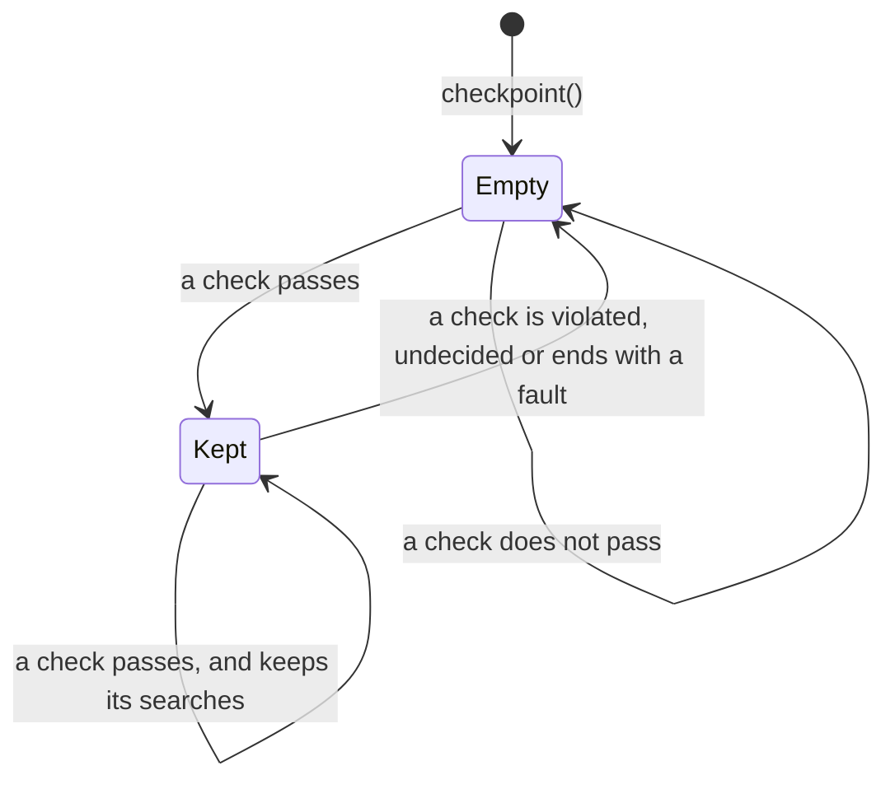

<!--
  ~ Copyright Dokimasia B.V. 2026
  ~ SPDX-License-Identifier: MIT
-->

# RFC-0064: A check that continues the searches of a growing history

## Summary

A machine with a spec checks its history after every sequential step. A
simulation checks its history after each step at which no client has an
open call.
Each check of `linearizable` searches every call of every partition again,
so a case of n steps costs about n²/2 steps of the spec. Go's library
continues the searches of the check before through `history.Resume` and
`history.Checkpoint`, which the naming table does not state. This proposal
adds both to the definition:

- The type `checkpoint` keeps the searches of the last check of a history
  that passed with it, one search for each partition.
- The option `history.resume(checkpoint)` makes a check continue those
  searches over the calls that the history recorded since. A check that
  passes keeps its own searches in the checkpoint.
- A continued search takes the steps that a search of every call takes
  after the order that the kept search found, so the check reports what a
  check of every call reports.
- A partition searches again from its first call when its kept search
  cannot continue as a search of every call.
- The steps of a machine pass a checkpoint of their case to every check.

Definition 16.6.0 adds the type, its constructor, the option and seven
vectors of a new kind, `resume`.

## Motivation

### Each check of a growing history searches every call again

The calls of the earlier checks are still in the history, so each check
searches them again. A case of n steps costs about n²/2 steps of the spec,
and the memo of each check grows with the calls of the history.

Go's library measured the growth on a machine over a register behind a
mutex, with 20 cases at seed 1 under Go 1.27.1:

| Steps at most | Time a case | Bytes a case |
|---|---|---|
| 50 | 329 to 385 µs | 1.29 MB |
| 100 | 0.93 to 1.20 ms | 4.98 MB |
| 200 | 3.73 to 3.83 ms | 19.14 MB |
| 400 | 14.7 to 15.1 ms | 78.5 MB |

With a checkpoint of the case, a case of at most 400 steps took 0.6 ms and
1.56 MB.

### Only Go continues a search

The naming table leaves `history.Resume` and `history.Checkpoint` to Go,
because the option does not change the result of a check. `Whole` and
`Final` are names of Go for the same reason. Python, TypeScript, Rust, Java
and Kotlin have no way to continue a search:

- A caller checks a growing history from its first call at every check, or
  checks it once at the end of a case. A violation then shows only at the
  end of the case, and each candidate of the shrinker runs the steps after
  the violation too.
- The steps of a machine search every call again after every sequential
  step.

A simulation that runs in Go and in TypeScript runs the same checks in
both languages. Its checks in Go continue the searches of the check
before, while its checks in TypeScript search every call again.

## Detailed design

### The checkpoint

```text
checkpoint() -> Checkpoint
    A checkpoint that does not keep a search.

history.resume(checkpoint) -> option of linearizable
    The check continues the searches that the checkpoint keeps, and keeps
    its own searches in the checkpoint when it passes.
```

After a check that passes with it, a checkpoint keeps these parts:

- the history, and the number of events that the check read
- the budget and the memo limit of the check
- the partition of each key, and of each call that the check read as
  pending
- for each partition, its calls and its search at the point where it
  passed: the entries, the linearized calls, the states, the stack, the
  memo, the steps and the frontier

A check that does not pass leaves the checkpoint without a search. That
covers a violated check, an undecided check and a check that ends with a
fault. A check that stops at its time limit is undecided, so it leaves the
checkpoint without a search too.

### The next check

A check with `resume` reads the events that the history recorded since the
kept check:

1. An event that completes a call that the kept check read as pending
   makes the partition of the call search again from its first call. A
   call that completes with `fail` leaves the history. The other calls of
   its partition then form the partitions of a check of every call.
2. Each new call joins the partitions of its keys, in event order. A call
   that does not declare a key joins every partition. A new call whose
   keys belong to no partition starts a partition. A partition that joins
   another searches again from its first call.
3. The check orders the partitions by their first invocation, as every
   check does.
4. A kept partition that does not search again grows its search by its new
   calls, and continues the search. A kept partition without new calls
   keeps its outcome without a step.
5. Every other partition searches from its first call.
6. The check sums the steps of the partitions in their order. It reports
   the first violated partition, else the first undecided one, as every
   check does.



### The equivalence with a search of every call

The search scans the entries in event order. It meets the invocation of a
new call only after it has linearized every call with a completion before
that invocation, and the events of the new calls follow every event that
the kept search read. So a search of every call of the partition takes the
steps of the kept search up to the order that the kept search found. The
kept search passed at that order.

From that order on, the search of every call continues over the new calls,
and a backtrack can return into the earlier calls. The grown search does
the same from the same stack, memo, frontier and step count. Its result is
the result of a search of every call:

- the outcome, and the steps up to it
- the frontier's order of calls, its states and its candidates
- the limit that stopped an undecided search

The memo limit counts one bit per call of the partition for each
configuration. A grown partition has more calls, so its memo may store
fewer configurations within the limit. A search of every call stops at the
limit before the order that the kept search found when the memo already
contains more configurations than the grown search may store. Such a
partition searches again from its first call.

### The conditions for a search from the first call

| Condition | Scope | Why |
|---|---|---|
| The checkpoint keeps no search | Every partition | The checkpoint is new, or the last check did not pass |
| The checkpoint keeps the searches of another history | Every partition | The calls differ |
| The budget or the memo limit differs from the kept check | Every partition | A search under other limits stops elsewhere |
| A new event completes a call that the kept search read as pending | The partition of the call | The call becomes known, becomes unknown, or leaves the history |
| A new call joins two or more partitions | The joined partition | Its calls interleave the calls of the partitions that it joined |
| The memo contains more configurations than the grown search may store | The partition | A search of every call uses up the memo limit before the order that the kept search found |

The steps of a search do not depend on the time limit or on the number of
workers, so these two settings may differ between two checks. A check on n
workers reports what one worker reports. It keeps the same searches too.

### The spec and concurrency

The kept searches contain the states that the spec of the earlier checks
left. Every check that passes one checkpoint must pass the same spec. In a
language whose checkpoint has the type of the states as a parameter, a
check with a spec of another type ends the call with a fault, as in Go. A
checkpoint compares no two specs of the same type, because a spec contains
functions and a caller may build an equal spec for each check. Python and
TypeScript have no type of the states at run time, so their checks
compare nothing. A checkpoint is safe for one check at a time.

The option applies to `linearizable` alone. The checks of `serializable`
and `snapshot-isolation` derive the dependencies between transactions and
search no spec, so they have no search to continue.

### The steps of a machine

The steps of a machine keep one checkpoint for each case, and pass it to
every check of the history. The check of a machine treats the whole
history as one partition, whatever keys its calls declare, so the
checkpoint keeps one search. Each check then continues the search of the
check before it.

The state of the next step is the first state after the order that the
check found. A continued search finds the order of a search of every call,
so that state, the verdicts and the records do not change. No vector of
machines changes.

### The languages

```go
// Checkpoint keeps the searches of the last check of a history that passed
// with it, one search for each partition. [Resume] passes it to a check. The
// zero Checkpoint does not keep a search.
//
// # Concurrency
//
// A Checkpoint is safe for one check at a time.
type Checkpoint[S any] struct{ /* unexported */ }

// Resume makes the check continue the searches that cp keeps, and keep its
// own searches in cp when it passes.
func Resume[S any](cp *Checkpoint[S]) Option
```

```python
class Checkpoint(Generic[S]):
    """The searches of the last check of a history that passed with it."""


def resume(checkpoint: Checkpoint[S]) -> Option:
    """Continue the searches of checkpoint, and keep the searches of a check that passes."""
```

```typescript
/** The searches of the last check of a history that passed with it. */
export class Checkpoint<S> {
  constructor();
}

/** Continues the searches of checkpoint, and keeps the searches of a check that passes. */
export function resume<S>(checkpoint: Checkpoint<S>): Option;
```

```rust
/// The searches of the last check of a history that passed with it. Clones
/// share the kept searches.
#[derive(Clone)]
pub struct Checkpoint<S> { /* private */ }

impl<S> Checkpoint<S> {
    /// Returns a checkpoint that does not keep a search.
    pub fn new() -> Self { ... }
}

/// States the checkpoint whose searches the check continues.
pub fn resume<S: Send + 'static>(checkpoint: &Checkpoint<S>) -> Options { ... }

impl Options {
    /// States the checkpoint whose searches the check continues.
    pub fn resume<S: Send + 'static>(self, checkpoint: &Checkpoint<S>) -> Self { ... }
}
```

```java
/// The searches of the last check of a history that passed with it.
public final class Checkpoint<S> {
  public Checkpoint() { ... }
}

public final class History {
  /// Continues the searches of checkpoint, and keeps the searches of a check
  /// that passes.
  public static <S> History.Option resume(Checkpoint<S> checkpoint);
}
```

Kotlin takes the Java types.

### Names

| Id | Go | Python | Rust | TypeScript | Java | Kotlin |
|---|---|---|---|---|---|---|
| `checkpoint` | `history.Checkpoint` | `history.Checkpoint` | `history::Checkpoint` | `history.Checkpoint` | `Checkpoint` | `Checkpoint` |
| `checkpoint.new` | | `Checkpoint()` | `Checkpoint::new` | `new Checkpoint()` | `new Checkpoint<>()` | `Checkpoint()` |
| `history.resume` | `history.Resume` | `history.resume` | `history::resume` | `history.resume` | `History.resume` | `History.resume` |

- Go declines `checkpoint.new`, because the zero `Checkpoint` does not
  keep a search.
- `Whole` and `Final` stay names of Go. A check of a caller partitions the
  history by its keys, and the check of a machine puts the whole history
  into one partition without an option.

### Conformance

A new vector kind, `resume`, is in `corpus/history/resume.json`. Each case
states these inputs, and every check of a case passes one checkpoint:

- a named spec
- a history, as a script in the JSON form of the history seam
- the checks, each with the number of events that it reads, and with a
  `budget` and a `memo-limit` where the check states them

```yaml
- id: resume/sequential-calls-step-each-new-call-once
  spec: register
  history:
    - {invoke: 0, client: 0, operation: write, args: [{type: int, value: 1}], keys: [{type: string, value: x}]}
    - {ok: 0, output: {type: "null"}}
    - {invoke: 1, client: 0, operation: write, args: [{type: int, value: 2}], keys: [{type: string, value: x}]}
    - {ok: 1, output: {type: "null"}}
  checks:
    - {events: 2}
    - {events: 4}
```

`make render` writes `results`, with one entry of `expect`, `detail` and
`next-calls` for each check. `next-calls` is the number of calls of the
spec's `next` that the check made. Each implementation records the history
up to each number of events and checks it with the checkpoint. It then
compares the three outputs with the vector, and counts the calls of `next`
through its own named spec.

The renderer also checks each prefix without a checkpoint. It fails when a
resumed check states another `expect` or `detail`. So the vectors pin that
a resumed check reports what a check of every call reports.

| Case | Pins | Count |
|---|---|---|
| Sequential calls over one key, checked after each completion | One call of `next` for each new call | 1 |
| A call that is pending at one check and completes before the next | A search of its partition from its first call | 1 |
| A new call that joins two partitions | A search of the joined partition from its first call | 1 |
| Two partitions, and only one gains calls | No call of `next` for the other partition | 1 |
| A violated check, then a check of a longer history | A search of every partition from its first call | 1 |
| A check under another budget than the check before it | A search of every partition from its first call | 1 |
| A grown partition whose memo passes what the grown search may store | A search of the partition from its first call | 1 |

That is 7 cases. The reference in `tools/history/` gains the checkpoint and
the grown search.

### Version

The type, its constructor and the option add names. They do not change the
meaning of an existing name. Definition 16.6.0 adds the three rows and the
vectors, and every overlay extends 16.6.0. The overlay of Go declines
`checkpoint.new`.

## Alternatives considered

### A. Continue only the search of a whole history

The checkpoint would keep one search of the whole history, as the check of
a machine needs and as the first form of Go's option did.

**Why not:** a check of a caller partitions the history by its keys, and
the definition has no option that puts every call into one partition. A
simulation over many keys needs a search for each partition. In one
partition of every key, each call of unknown outcome is concurrent with
every later call, and multiplies the orders that the search tries.

### B. A checkpoint for each key

The caller would keep one checkpoint for each key, and check the calls of
each key apart.

**Why not:** a partition is a set of keys that the calls connect, and a
call with two keys joins two partitions. The caller would compute the
partitions again. It would also join the records of its checks into the
record that one check states.

### C. The partitions of every call at each check

Each check would compute the partitions of every call. It would continue
the search of each kept partition whose calls start one of its new
partitions.

**Why not:** the work of each check would grow with the history, because
the check would read every event of the history. A check with a
checkpoint reads only the events since the check before it.

### D. A check from a cut of the history

The caller would check only the calls after the last check, from the
states that the last check left.

**Why not:** a call before the cut can take effect after a call after the
cut when the two are concurrent. A check from a cut accepts some orders
that a check of every call refuses. It also refuses others. Its verdicts,
its steps and its frontier would then differ from a check of every call.
Every vector would need a rule of its own.

### E. The names in Go alone

The option would stay a name of Go, as `Whole` and `Final` do.

**Why not:** the option does not change a result, but it changes the cost
of the checks of a case from quadratic to linear in its steps. A caller in
another language has no other way to get that cost.

## Drawbacks

- **One memo for each partition.** A checkpoint keeps the memo of each
  partition between checks. That is the memory of a check of every call,
  for the life of the checkpoint.
- **A search from the first call after each completion.** A call that is
  pending at one check and completes before the next makes its partition
  search from its first call. In a simulation whose calls are open for two
  or more steps, each completion of such a call costs a search of its
  partition from its first call.
- **The bookkeeping of the checkpoint.** The checkpoint keeps the
  partition of each key and of each pending call.
- **The grown search.** Each implementation changes its search so that it
  can add entries to a search that passed. The indices of the entries stay
  the same, the set of linearized calls gains calls, and the key of a
  configuration in the memo must not change when the set grows. Go made
  five such changes.
- **The vectors.** The runner of history vectors of each implementation
  gains the kind `resume` and a counter of the calls of `next` of its
  named specs.
- The naming table gains three rows, and the reference gains the
  checkpoint and the grown search.

## References

| What | Where |
|---|---|
| The issue | <https://github.com/dokimasia/assert-spec/issues/37> |
| The search, its partitions, its limits and its frontier | RFC-0004 |
| The check of a machine after every step | RFC-0012 |
| The spec of a check | RFC-0026 |
| The memo of the calls without a completion | RFC-0051 |
| Go's checkpoint of a whole history, and the measurements of a machine | <https://github.com/dokimasia/assert-go/blob/main/docs/rfc/0013-resuming-the-check-of-a-growing-history.md> |
| Go's checkpoint of each partition | <https://github.com/dokimasia/assert-go/blob/main/docs/rfc/0025-resuming-each-partition-of-a-growing-history.md> |
| Wing and Gong, "Testing and verifying concurrent objects", the scan that the search runs | Journal of Parallel and Distributed Computing 17, 1993, pages 164 to 182 |
| Lowe, "Testing for linearizability", the memo of configurations | <https://www.cs.ox.ac.uk/people/gavin.lowe/LinearizabiltyTesting/paper.pdf> |
